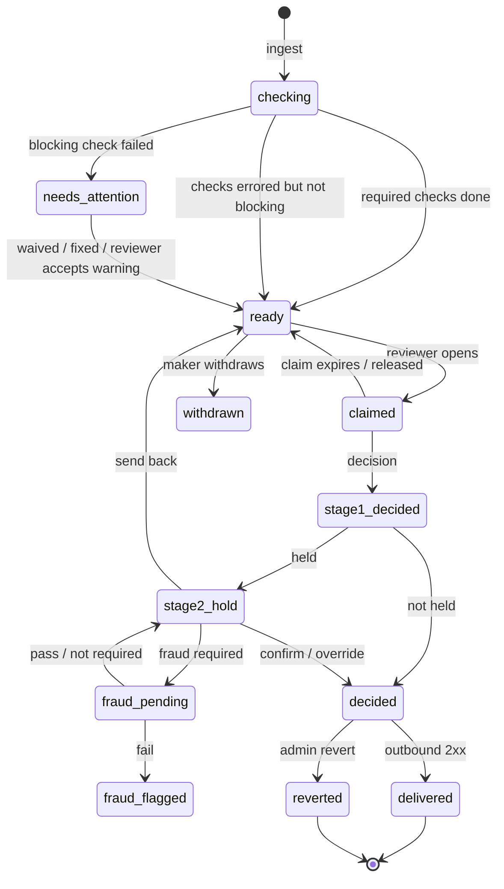

# 01 – Product

This document defines what the review platform is for, who uses it, how work moves through it, and what "done" means. It is deliberately more specific than a feature list: the stage model and the stage 1 speed budget are the product.

## The problem

Half Life uses Ari, a review platform built for Hack Club's Macondo programme. Ari is good at the part that is hard to replace:

- reviewers know it;
- the automatic checks are thorough;
- the queue, claims, evidence and second pass already work.

It fits Half Life badly in three ways:

1. **Shape.** Macondo is mostly software. Half Life is five hardware design weeks and five build weeks. Some Ari concepts (collaborative ships, software demo requirements, reviewer VMs, NDA evidence) are dead weight. Some Half Life concepts (theme-specific repo requirements, BOM funding, design-then-build ordering) are not native.
2. **API opacity.** A lot of what Half Life needs is only available through side effects: decisions arrive as webhooks, the status endpoint is a subset, notes and approved hours are missing from some paths, and the workaround is to resend from the admin panel and catch it server-side. That is not a stable integration.
3. **Configuration.** Ari's workflow is a set of booleans built around its own second pass. Half Life wants a first review that is fast and mostly final, a second stage that only sees what needs a second look, and fraud review only at that second stage. Ari can approximate that; it cannot express it cleanly.

The opportunity is not "Ari but shinier". It is a review surface shaped like Half Life's actual work, with the checks and familiarity that make Ari good, and an API that a backend can trust.

## Users

| User | What they do | What they need |
| --- | --- | --- |
| **Reviewer** (stage 1) | Works the hardware design/build queue, reads evidence, approves or returns work | Speed, consistency, enough evidence to be fair, no ceremony |
| **Organiser** (stage 2) | Confirms held decisions, reviews fraud results, overrides, handles escalations | Context from stage 1, a clear reason for the hold, authority to change the outcome |
| **Programme admin** | Configures stages, checks, forms, snippets, members and integrations | Live configuration with an audit trail; no redeploy for a policy change |
| **Auditor** | Reads decisions, overrides and check history | Immutable records, filters, export |
| **Half Life backend** | Sends ships, receives decisions, reconciles state | Signed, idempotent, fully readable API |
| **Maker** (indirect) | Submits in Half Life and receives an outcome | A fair, timely decision; no new place to log in |

Reviewers are the volume users. Every product decision should be judged by whether it makes a competent reviewer's next decision faster without making it worse.

## Stages

### Stage 0 – automatic preflight

Stage 0 is not a human queue. It is the pipeline that runs between ingest and a reviewer seeing the ship.

- The submission is validated and snapshotted.
- Check jobs run against the repo, the journal, Hackatime, timelapse clips, the demo link and identity.
- The submission becomes `ready` when the checks required for review have finished, `needs_attention` when a blocking check failed, or stays `checking` while jobs run.
- A check that could not run (network, rate limit) is `error`, not `fail`. Reviewers see "could not check" and can still decide with an acknowledgement.

The output of stage 0 is a **check summary** attached to the submission version. It is immutable for that version. Re-running a check creates a new result set; the review screen shows both the latest result and when it was taken. A blocking failure can put a ship in a small **needs attention** queue, but that is an exception queue for a human to resolve, not the normal stage 1 queue.

### Stage 1 – reviewer

The default queue. A reviewer opens a ship, reads the evidence, and decides:

- **Approve** – credit the work and move on.
- **Request changes** – send it back with a note.
- **Reject** – no credit; a note is required.

A stage 1 decision can be final, or it can be held for stage 2. The policy decides. The reviewer always sees whether their decision will be final or held *before* they confirm.

Stage 1 is where the speed budget lives. A clean submission should take under two minutes; a submission with warnings should take under five. Anything longer must be because the work is genuinely hard, not because the tool is slow.

### Stage 2 – organiser and fraud

Stage 2 is a second look, not a second queue for everything.

It holds only the decisions policy names. Examples:

- every approval for a programme that wants full oversight;
- approvals above an hours or grant threshold;
- approvals carrying a risk flag;
- a random sample for quality assurance;
- every decision from a reviewer in their first week;
- anything the stage 1 reviewer explicitly escalates;
- anything fraud review is required for.

Fraud review runs here and only here. A stage 1 decision that is not held never calls the fraud provider. A held decision waits for the fraud result before an organiser can confirm it (unless policy says otherwise).

Stage 2 actions:

- **Confirm** the held decision (final).
- **Override** to a different decision (reason required).
- **Send back** to stage 1 (reason required; the held decision is invalidated and the ship returns to the queue).
- **Flag** the maker/account (fraud or manual).

An organiser cannot confirm their own stage 1 decision. That is the point of a second pair of eyes.

### Terminal states

`approved`, `changes`, `rejected`, `withdrawn`, `reverted`, `fraud_flagged`.

A decision is not terminal until the outbound delivery to Half Life succeeds. The review is recorded first, then delivered. A failed delivery is visible and retried; it is never silently dropped.



## The stage 1 speed budget

Speed is a product requirement, not a later optimisation. The following tactics are part of v1.

### Before the reviewer opens anything

- **Auto-claim.** Opening a ship claims it. There is no separate "claim" button, no modal, no "start review" step. The claim has a TTL and a heartbeat; navigating away releases it.
- **One bundle.** The review page is one `GET` with the project, checks, evidence summary, hours, prior reviews and policy. The browser does not make five requests to assemble a screen.
- **Prefetch.** The queue prefetches the next three ships' bundles on idle. Opening the next ship is instant.
- **Checks are precomputed.** Stage 0 has already done the work. The review page renders results; it does not wait for GitHub.
- **Queue is honest.** The default sort is oldest first. A "ready to approve" filter shows only clean ships. A "needs a look" filter shows warnings. The reviewer can choose speed or care without changing tools.

### On the screen

- **One screen, no wizard.** Stage 1 shows the evidence, the hours and the decision controls together. There is no step-by-step gate unless the programme explicitly configures required fields.
- **Approve is the default action.** It is the primary button, it shows the hours it will credit, and it is enabled as soon as the policy allows. Notes are optional on approval by default.
- **Two-keystroke approval.** `A` (or `Ctrl/Cmd+Enter`) opens a compact confirm popover with the hours and note; `Enter` confirms. A clean ship can be approved without touching the mouse. If the programme wants a single click, that is a policy option; the default keeps a confirmation because approval moves money.
- **Request changes and reject are one keystroke away.** They require a note, because the maker needs to know what to fix. The note editor opens focused.
- **Warnings are inline and acknowledgeable.** A yellow check does not open a dialog. It sits in the preflight strip; approving with an unacknowledged warning shows one compact confirmation, not a maze.
- **Only the fields that matter.** Stage 1 defaults: no technical-features essay, no 100-character internal note, no checklist, no custom fields. Those exist, but they are stage 2 or programme opt-ins.
- **Snippets, not blank pages.** Common notes are one keystroke away. A default approval note is pre-filled and editable.
- **Auto-advance.** After a decision, the next ship loads. A toast says "Next up · 2 of 14" with a "stay" action. The reviewer can keep working without returning to the queue.
- **Resubmission diff.** For a new version of a ship, the top of the evidence says what changed since the last decision: new commits, new journal entries, new files, new clips. The reviewer does not re-read a project they already reviewed.
- **No page reloads.** SPA navigation, cached queue, optimistic claim, SSE for queue changes.

### What stage 1 does not show

- Fraud internals. A held-for-fraud ship shows "stage 2 · fraud" as a status; the reviewer does not see the score or rules.
- Maker email, Slack ID or identity documents. Stage 1 sees the display name. Stage 2/admin sees contact details.
- Reviewer VMs, NDA evidence, collaborative splits, software demo requirements.
- A wall of every check. The summary is one line per check; detail expands.

### Target numbers

| Metric | Target |
| --- | --- |
| Median stage 1 decision, clean ship | < 90 seconds |
| p90 stage 1 decision, clean ship | < 3 minutes |
| Median stage 1 decision, warned ship | < 5 minutes |
| Queue age, p90 | < 24 hours during the season |
| Page load to interactive, cached ship | < 300 ms on a laptop |
| Decisions per reviewer per hour | measured, not gamified |

These are not performance-review metrics for individuals. They are product health metrics. A high decisions-per-hour number with a high reversal rate is a failure.

## Stage 2 policy

Stage 2 exists to answer a different question from stage 1: "Should this decision stand?" It is not a place to redo the review from scratch.

### Hold rules

A hold rule is a named condition. The policy engine evaluates them in order and records the first reason that applies.

- **Decision kind.** Hold approvals, changes, rejections, or any combination.
- **Risk.** Any blocking-adjacent warning (plagiarism, duplicate repo, hours reuse, identity mismatch, low timelapse coverage, suspicious commits).
- **Hours or grant.** Approved seconds or grant amount above a threshold.
- **Reviewer.** New reviewer, probation period, or a reviewer who has asked for a second look.
- **Sample.** A deterministic random sample (hash of submission id + salt) so the same ship is not re-rolled on retry.
- **Fraud.** Fraud is required by policy.
- **Always.** A programme that wants a second pass on everything.

### Stage 2 screen

The stage 2 screen reuses the stage 1 evidence, with three additions:

1. **Held decision panel** – what stage 1 decided, who, when, the note, the hours, and the hold reason.
2. **Fraud panel** – provider status, verdict, score and a plain-language explanation. No raw private rules.
3. **Confirm / override / send back** – the three actions, with a required reason for override and send-back.

The organiser sees the same checks and evidence, so confirming is a real second look, not a rubber stamp. On confirm, the final review records both stages and the organiser's identity.

### Fraud

Fraud is a provider call, not a feature built into the review UI.

- It is enabled per programme.
- It is constrained to `stage == 2`; the config validator refuses any other stage.
- It runs when the submission enters stage 2, or on a retry.
- The result is `passed`, `failed`, `error` or `skipped`.
- A failure flags the maker through the outbound event; policy decides whether the ship is held, rejected, or left for an organiser.
- An error holds the ship and shows "fraud unavailable"; an organiser can retry or override with a reason, and the audit records it.

No stage 1 code path calls the provider. This is enforced in the service layer, not just hidden in the UI.

## Workflows

### A clean design submission

1. Maker submits in Half Life. Half Life sends a signed ship.
2. Review snapshots it and enqueues checks. Repo and evidence checks finish in seconds.
3. The ship appears in the stage 1 queue with a green preflight.
4. Reviewer opens it; auto-claimed; bundle is already prefetched.
5. Reviewer reads the README, BOM and a few journal entries; approves in two keystrokes.
6. Policy: no hold (clean, under threshold). Final review written; outbound `review.approved` delivered.
7. Half Life applies the decision, sets the tier/grant, credits hours, notifies the maker.
8. Reviewer auto-advances to the next ship.

### A warned build

1. Checks find the README has no BOM table and the timelapse covers 12% of claimed time.
2. The ship is `ready` with two warnings. Stage 1 sees amber badges and a one-line reason for each.
3. Reviewer opens the evidence, watches the clip, reads the journal, and decides to request changes.
4. Note is required; snippet picker offers "Please add a BOM table and a longer timelapse".
5. Policy holds changes? No by default. Final `review.changes` delivered.
6. Half Life returns the phase, grants an extension and notifies the maker.

### A held approval with fraud

1. Stage 1 approves a high-hours design. Policy holds approvals above 20h.
2. The ship moves to stage 2, `fraud_pending`; fraud job runs.
3. Fraud passes. Organiser opens the held decision, sees stage 1's note and hours, confirms.
4. Final review written; outbound delivered. The maker sees one decision, not two.

### A fraud failure

1. Fraud returns `failed`.
2. The ship is `fraud_flagged`; the maker is flagged through the outbound event.
3. Policy: hold for an organiser, do not auto-reject. The organiser sees the verdict summary and can reject, request changes, or clear with a reason.
4. Every path is audited.

### A resubmission

1. Half Life withdraws the old ship and sends a new version of the same `external_id`.
2. Review keeps the old version and its decision; the new version is a new row.
3. The review screen shows the diff since the last decision and any prior decision notes.
4. The old ship cannot be decided; the new one has its own claim, checks and decision.

### An override after delivery

1. An admin reverts or requeues a decided ship.
2. Review invalidates the review, releases the claim, and writes an outbound `review.reverted` or `review.requeued`.
3. Half Life reverses credit or returns the ship to the queue.
4. The audit trail keeps both decisions and the reason.

## Half Life invariants the product must respect

These are not optional integration details. The UI and the policy engine must reflect them, or a reviewer will make a decision the backend refuses.

- **A build may be submitted before its design is approved.** Half Life allows this deliberately, so a maker is not blocked by review capacity. Review can show and queue the build, but a build approval must be disabled with "Waiting for design approval" until the design is approved. Do not let a reviewer spend time on an approval that cannot land.
- **Design approval is the funding decision.** The design review sets the tier and the parts grant. A build has no tier. Review displays the tier the maker requested and the BOM total; it sends an hours decision and, if the reviewer changes it, a tier override. Half Life remains the writer.
- **A design cannot be approved below its tier's funded-hours floor.** Half Life refuses it. Review should show the floor and explain why the tier must step down, rather than letting the reviewer hit a server error.
- **Stale Hackatime blocks approval unless the reviewer sets an explicit hours value.** Review must show the stale state, not a zero, and must not silently approve on a cached number.
- **One open ship per `(project, phase)`.** A new hand-in while one is open is a `409 already_queued` with the existing id. Half Life adopts that id; Review must return it.
- **Nobody reviews their own work.** The queue, direct URL, claim and decision all refuse it. Admin does not bypass this.
- **A returned phase grants its own extension.** Half Life writes the extension; Review does not. It only needs to deliver the `changes` decision promptly.
- **Half Life's `finalizeReview` is the only writer of credit.** If Review's decision is refused (order, stale hours, tier), the outbound delivery fails and is retried; Review must show that state, not pretend the decision is complete.

If a rule changes in Half Life, it changes here in the same release. The integration tests should encode these invariants.

## Ari parity

The goal is not pixel parity. It is **no relearning**. A reviewer should recognise the shape and know where everything is.

| Ari | Review | Notes |
| --- | --- | --- |
| Queue, filters, priority, oldest first | Same | Add a "ready to approve" / "needs a look" split |
| Claim, heartbeat, finish session | Same | Auto-claim on open; release on navigate |
| Review screen: header, evidence dock, rail, decision footer | Same two-pane shape | Stage 1 rail is simpler; stage 2 adds held/fraud panels |
| Evidence: commits, devlog, Lapse, README, files, past reviews | Same | One bundle; prefetch; resubmission diff |
| Hours rail, per-source adjustments, deflation | Same | Seconds model; sends approved seconds to Half Life |
| Checklist, custom fields, snippets | Same | Stage-scoped; off by default in stage 1 |
| Second pass | Stage 2 | Configurable holds and fraud |
| Fraud review | Stage 2 only | Provider interface |
| Reviewer VMs | Dropped | Not needed |
| NDA evidence | Dropped | Not needed |
| Collaborative ships | Dropped | Half Life is solo |
| Software track | Deferred | Hardware first; track is a column |
| Reviewer reauth | Optional | HCA prompt if a programme wants it |
| Priority review form | Not in Review | Half Life owns the maker-facing form |
| MCP / agent API | Deferred | Add later if reviewers ask |
| Activity log / leaderboard | Same idea, simpler | Audit-backed |
| `ship.updated` edits | Deferred | Reviewer notes instead; add if needed |

### Vocabulary

Use the words reviewers already know:

- "Needs review", "In review", "Stage 2", "Approved", "Changes requested", "Rejected".
- "Claim" and "Finish session".
- "Note to maker" and "Internal note".
- "Hours" and "coverage".
- "Approve", "Request changes", "Reject".

Avoid inventing a new taxonomy for the same things. "Stage 2" is the only new word, and the UI can gloss it as "second pass" the first time.

## Configuration

Configuration is data, not code. The admin UI edits rows; the change is audited; the running service reads the current version on the next request.

### What is configurable

- Programme name, timezone, tracks, active season.
- Stage 1 requirements: note on approval, internal note, checklist, custom fields, technical features, warning acknowledgement, hours adjustment reason.
- Stage 2: enabled, held decision kinds, hold rules, thresholds, sample rate, organiser bypass, own-decision rule.
- Fraud: enabled, stage (must be 2), provider, trigger rules, on-fail/on-error behaviour, timeout.
- Checks: which checks block ingest, which block approval, which are advisory; per track, theme and phase.
- Forms: checklist items, custom fields, snippets, default approval note.
- Queue: default sort, review goal, claim TTL, auto-advance.
- Integrations: outbound URL, secret last-4, event selection.
- PII visibility: who sees maker contact details.

### Example policy

```json
{
  "stage1": {
    "note_on_approve": "optional",
    "internal_note": "optional",
    "checklist": false,
    "custom_fields": false,
    "technical_features": false,
    "require_warning_ack": true,
    "auto_advance": true,
    "claim_ttl_minutes": 30
  },
  "stage2": {
    "enabled": true,
    "hold": {
      "decisions": ["approved"],
      "when": ["fraud_required", "risk.any", "hours_over:72000", "sample:0.05"],
      "organizer_bypass": true
    },
    "require_reason_on_override": true,
    "require_reason_on_send_back": true
  },
  "fraud": {
    "enabled": true,
    "stage": 2,
    "provider": "external",
    "trigger": ["stage2", "hours_over:36000"],
    "on_fail": "hold",
    "on_error": "hold",
    "timeout_seconds": 15
  }
}
```

The numbers above are examples, not defaults. Defaults should be conservative: no fraud, stage 2 holds nothing unless configured, stage 1 notes optional.

### What is not configurable

- Secrets. They live in the platform secret store, not the database.
- The stage 2 constraint on fraud. It is a validation rule.
- The money model. Half Life owns it.
- The existence of an audit trail.
- Self-review prevention.

## Metrics

Product metrics:

- queue depth by stage, theme and phase;
- time in queue (p50/p90), time to first review;
- stage 1 decision time (clean vs warned);
- decisions per reviewer per hour (for capacity, not ranking);
- stage 2 hold rate and confirm/override rate;
- fraud pass/fail/error rate;
- check failure and error rates by check;
- outbound delivery success and retry depth;
- approvals reversed within 14 days.

Reviewer-facing metrics:

- personal weekly goal (optional, visible to the reviewer);
- team queue health;
- reviewer leaderboard (opt-in; not used for pay).

Operational metrics:

- `checks_running` older than 5 minutes;
- `stage2_hold` older than 24 hours;
- outbound backlog;
- storage errors, 5xx rate, p95 request time;
- disk usage and backup age.

## Non-goals and deliberate omissions

- **No ledger.** Review never credits coins. It sends a decision.
- **No maker UI.** Half Life is the maker's surface.
- **No reviewer VMs.** Hardware review does not need an ephemeral desktop.
- **No NDA vault.** Review does not collect identity documents or private evidence.
- **No collaborative ships in v1.** The data model has a `maker` object and can grow a `collaborators` array, but Half Life hardware is solo.
- **No software track in v1.** The check policy and track column are ready; the UI and default checks are hardware.
- **No email delivery.** Half Life notifies makers. Review can post reviewer ops to Slack later.
- **No public queue.** Reviewer capacity is internal.
- **No automatic rejection on check failure.** A failed check is a human decision, unless a programme explicitly opts into auto-reject for a specific check.
- **No AI review in v1.** The fraud provider can use whatever it wants; Review does not embed prompts.
