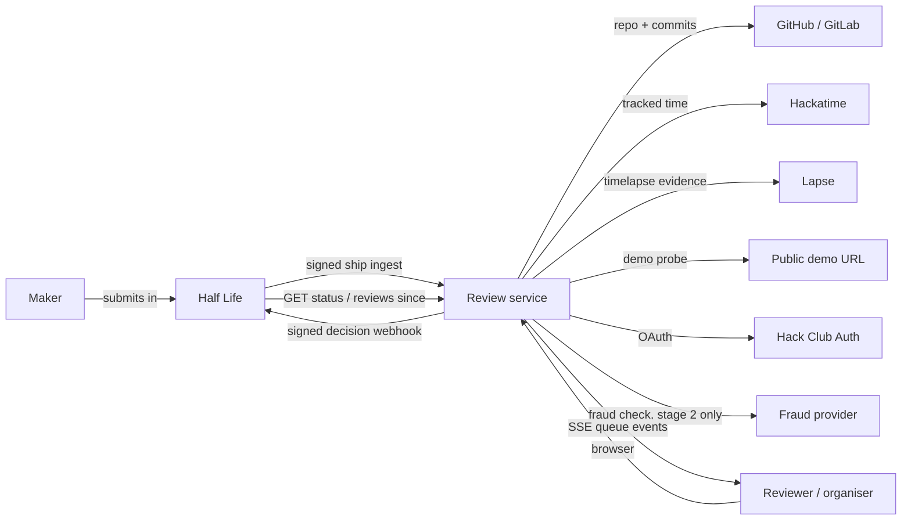
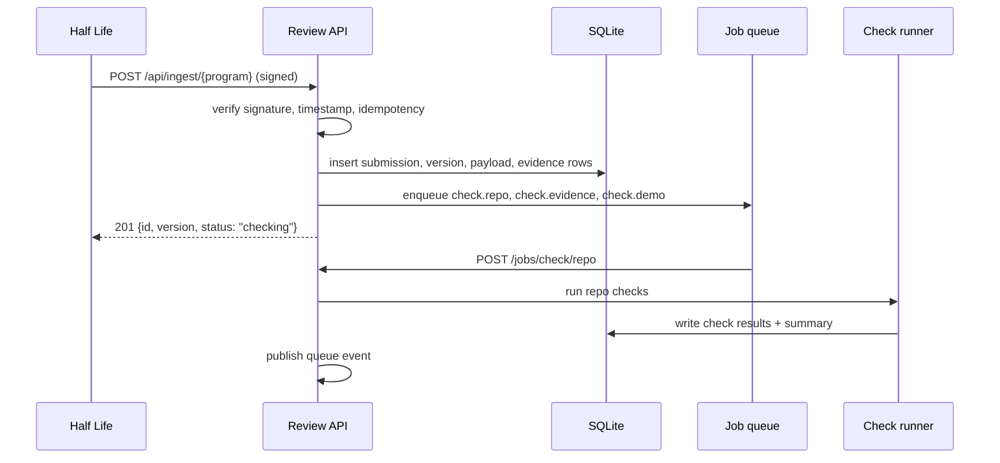
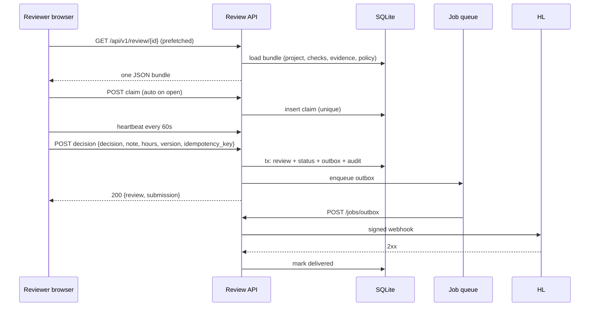

# 02 – Architecture

## System context



Review is one `wt` app:

- a Go API compiled to a Wasm component;
- a prerendered SvelteKit frontend served as static files by the supervisor;
- a per-app SQLite database reached through the supervisor's loopback storage service;
- host-driven schedules and durable jobs for checks and outbound delivery;
- the supervisor's SSE event bus for queue updates;
- signed blob URLs if reviewer attachments are added later.

There is no second service and no shared Postgres. Ari's split between `ari` and `ari-webhooks` exists because Ari needed a separate ingestion/enrichment service; `wt`'s job queue replaces that split. If check load ever outgrows one app, the checks runner can become a second `wt` app behind the same database boundary, but that is not a v1 requirement.

## Why this shape

The repository is already a `wt` app. `wt` supports exactly one production shape for a web app:

- `adapter-static` SvelteKit, `prerender = true`;
- no `+page.server.ts`, `+layout.server.ts`, `+server.ts`, `hooks.server.ts` or server modules;
- a Go component for every dynamic request;
- per-app SQLite through an HTTP storage service;
- host schedules and jobs for anything asynchronous.

Fighting that shape would mean replacing the deployment tool. Fitting it means the app is cheap to deploy, backup and roll back, and the constraints are known.

## Runtime constraints and how the design answers them

| Constraint | Consequence | Design answer |
| --- | --- | --- |
| Wasm component only runs while handling a request | No background goroutines, no timers | `schedule` entries call `/jobs/tick`; durable jobs carry payloads and retries |
| One instance handles one request at a time | No shared in-memory cache across requests | SQLite is the cache; per-request data is loaded in one bundle |
| SQLite query timeout 5s | A slow query is a failed request | Indexed queue queries; precomputed check summaries; no unbounded `COUNT(*)` on hot paths |
| SQL statement limit 64 KiB, value 1 MiB, response 8 MiB | Large payloads fail | Cap README/tree/journal sizes; paginate evidence; store only metadata, not media |
| 10,000 row response cap | A list endpoint can be huge | Keyset pagination; `max_rows`; summary endpoints |
| Single writer | Long writes block decisions | Short transactions; jobs do network I/O outside transactions; outbox row in the same transaction as the decision |
| No WebSocket | Live updates need another path | Supervisor SSE event bus, with polling fallback |
| Static frontend only | No SSR, no server load | Prerender the shell; fetch after hydration; loading skeletons |
| Migration runs at startup | A bad migration blocks the app | Expand/contract, checksummed migrations, test on a scratch DB, backup before deploy |
| 128 MB default memory | Large JSON parsing can hurt | Stream where possible; cap payloads; keep check jobs small |

## Components

```text
cmd? no – one package main
├── main.go                 domain, handlers, policy, auth
├── wasm.go                 //go:build wasip1: storage, migration, wasi:http
├── internal/
│   ├── auth/               HCA OAuth, sessions, memberships, authz
│   ├── domain/             submissions, claims, reviews, stages, hours
│   ├── policy/             pure stage/check/fraud rules
│   ├── checks/             check registry + forge/hackatime/lapse/demo
│   ├── jobs/               job handlers + tick
│   ├── outbox/             signed delivery + retry
│   ├── api/                HTTP handlers and DTOs
│   └── store/              SQL, migrations, queries
├── contract/               generated Go types from Valibot
└── web/                    static SvelteKit frontend
```

The scaffold's `notesApp` shape is the right starting point: handlers hang off an `app` struct with a `store`, and `wasm.go` is the only file that knows about wasmtime. Keep that separation. Handler tests use `storage.NewTestServer` and never need wasmtime.

### API edge

The HTTP layer is thin:

- decode and validate request DTOs (generated from Valibot);
- authenticate (session cookie or machine bearer/HMAC);
- authorise (programme membership, stage, track, self-review);
- call a domain function;
- encode the response DTO or the shared error envelope.

No SQL in handlers. No policy in handlers. No signature verification in a handler that also does business logic.

### Domain

Domain functions are pure where possible and transactional where not:

- `ingestShip`, `withdrawShip`;
- `claim`, `heartbeat`, `release`;
- `decideStage1`, `confirmStage2`, `overrideStage2`, `sendBack`;
- `recordFraud`;
- `revert`, `requeue`;
- `computeQueue`, `loadReviewBundle`.

They take a `store` interface so tests can use the in-memory test server. They return typed outcomes, not HTTP errors; the handler maps outcomes to status codes.

### Policy

A pure package with no imports from `net/http` or the database. It is the most heavily tested code in the repo.

```go
type Stage1Input struct {
    Submission Submission
    Checks     CheckSummary
    Program    ProgramPolicy
    Viewer     Viewer
    Claim      ClaimState
    Draft      DecisionDraft
}

type Stage1Outcome struct {
    Allowed   bool
    Problems  []Problem   // field-level reasons
    Hold      bool
    HoldReason string
    Final     bool
}
```

The UI calls a read-only validation endpoint (or receives the same result in the review bundle) so it can disable buttons and explain why. The server calls the same function before writing. One implementation, two callers.

### Checks

A registry of check groups:

- `repo`: forge snapshot, README, file kinds, BOM, design JSON;
- `commits`: history, authorship, spread;
- `hackatime`: tracked time in the window, stale state;
- `lapse`: clips, coverage;
- `demo`: URL probe;
- `identity`: HCA verification status;
- `duplicate`: repo/evidence reuse;
- `fraud`: stage 2 only, external provider.

Each check is a small function over a snapshot and policy. A runner executes a group with bounded concurrency and a per-check timeout, writes results, and updates the submission's check summary.

See [04-checks.md](./04-checks.md).

### Jobs

`wt` jobs are HTTP calls back into the app:

- `POST /jobs/tick` every minute, from `app.json` `schedule`;
- `/jobs/check/repo`, `/jobs/check/evidence`, `/jobs/check/demo`, `/jobs/check/fraud`;
- `/jobs/outbox` for due deliveries;
- `/jobs/reconcile` for stuck claims, stale checks and stats rebuilds.

Every job is idempotent. The payload carries the submission id, version and group. The job checks the current state before doing work:

- if the submission is gone, withdrawn or newer, it is a no-op;
- if the check result already exists for this version, it is a no-op unless `force`;
- if the outbox row is already delivered, it is a no-op.

Jobs are at-least-once. The database is the source of truth for whether work is done.

### Outbox

A decision transaction writes:

1. the review row;
2. the submission status;
3. the outbox row with the exact signed payload;
4. the audit row.

After commit, the handler enqueues an immediate outbox job. If the enqueue fails, the schedule tick picks up due rows. The worker:

- claims a row with a compare-and-set (`status = 'pending' AND next_attempt_at <= now`);
- signs and sends;
- records HTTP status, error, attempt count and next attempt;
- marks `delivered` on 2xx;
- backs off exponentially on 5xx/timeout/429;
- marks `failed` after the configured attempts, visible in admin.

The payload is stored before sending, so a restart does not lose it and an operator can inspect exactly what was sent.

### Frontend

SvelteKit static shell, client-side routing. The frontend owns:

- queue state and filters;
- review bundle cache and prefetch;
- claim heartbeat;
- draft autosave (debounced);
- decision submission and optimistic navigation;
- keyboard shortcuts;
- SSE subscription with polling fallback.

The API client validates every request and response through the same Valibot schemas that generated the Go types. A response shape mismatch is a client error, not a blank page.

## Data flow

### Ingest



### Review



### Reconciliation

A receiver can always recover:

- `GET /api/v1/status/{program}?external_id=...` – current version, stage, decision, review, checks, fraud, timeline.
- `GET /api/v1/reviews/{program}?since=...` – every final decision since a time, with notes and hours.
- `GET /api/v1/events/{program}?since=...` – every transition, including withdrawals, claims, holds and overrides.

No admin-panel resend is required to discover state.

## Authentication and authorisation

### Reviewer auth

HCA OAuth 2.0 authorisation code with PKCE. Use the scopes `openid profile email slack_id` (the same as Ari); do not request the legal-name scope, because HCA's name claim can deadname. The flow:

1. `GET /auth/login` creates state, nonce and PKCE verifier rows; redirects to HCA.
2. HCA redirects to the static `/auth/callback/` page.
3. The page POSTs `code` and `state` to `/api/auth/callback`.
4. The Go component exchanges the code, verifies the ID token against HCA's JWKS, reads userinfo, and sets an opaque session cookie.
5. The session row stores a hash of the token; the cookie is `HttpOnly`, `SameSite=Lax`, `Secure` behind HTTPS.

The app uses the v2 SDK: `packages/v2/oauth` and `packages/v2/session` for sign-in, `packages/v2/sign` for webhook signatures, and `packages/v2/outbox` for the signed delivery queue. It does not invent a token format or a retry loop.

### Membership

Signing in does not grant access. A `user` is created or matched by lowercased HCA email. A `membership` row connects the user to a programme with a role:

- `admin` – programme settings, members, overrides, audit.
- `organizer` – stage 2, fraud review, overrides.
- `reviewer` – stage 1.
- `auditor` – read-only.

Track scope is a column (`hardware` now; `software` later). Stage scope is derived from role plus policy. A reviewer can be a stage 1 reviewer on one track and an organiser on another if the programme needs it; v1 does not expose that complexity in the UI.

### Machine auth

- Ingest and withdraw: HMAC signature over `timestamp.body` with the programme signing secret.
- Status/list: `Authorization: Bearer <programme signing secret>` (the same secret Ari's status endpoint uses) or a separate read key.
- Outbound: Review signs; Half Life verifies with the outbound secret.
- No cookies on machine endpoints. No bearer on browser endpoints.

### Authorisation rules

Centralised in `internal/authz`:

- `CanReviewStage1(user, programme, track)`;
- `CanReviewStage2(user, programme, track)`;
- `CanOverride(user, programme)`;
- `CanManageProgram(user, programme)`;
- `CanViewPII(user, programme)`;
- `CanViewSubmission(user, submission)`.

Rules:

- Every query filters by programme and membership.
- A resource the user cannot see is a `404`, not a `403`, when its existence is sensitive.
- Self-review is forbidden at query, claim and decision time. Match by HCA email, Slack ID, Hackatime ID and, if available, the maker's user id.
- Stage 2 cannot confirm the organiser's own stage 1 decision.
- Admin does not bypass self-review. Admin can override a decision, but not review their own work.
- PII (email, Slack ID, identity status) is redacted before serialisation for roles that should not see it.

## Security

### Input and transport

- Raw-body signature verification before JSON parsing. Do not re-serialise a signed body.
- Timestamp within 300 seconds; reject missing/invalid timestamps for new senders. Accept Ari's legacy body-only signature only on the compatibility endpoint.
- Constant-time comparison.
- Delivery id unique; replay returns the original result, not a second write.
- Request body caps (ingest 1 MiB, decision 64 KiB, notes 16 KiB).
- Strict JSON decoding; unknown fields rejected where the contract says so.

### SSRF and external fetches

Repo, demo, thumbnail and provider URLs are attacker-controlled.

- Only `https`.
- Resolve DNS; reject private, loopback, link-local, multicast and metadata addresses.
- Follow at most two redirects; re-check each hop.
- `GET`/`HEAD` only; no request bodies.
- 10-second timeout; 2 MiB response cap.
- A blocklist for known bot-walled demo hosts, with a "left for human review" result rather than a failure.
- Never fetch a private repo's contents. If the forge token can see a repo the public cannot, treat it as not found.

### Browser

- CSP: default-src self; img-src self, data:, and the known media hosts; connect-src self; frame-ancestors none; no inline scripts.
- All writes are `POST`/`DELETE` with same-origin checks or a CSRF token.
- Session cookie `HttpOnly`, `SameSite=Lax`, `Secure`.
- OAuth state/nonce/PKCE; callback validates state before exchange.
- No maker PII in client logs or URLs.
- `Referrer-Policy: no-referrer` on external links.
- Thumbnails and avatars are loaded with `referrerpolicy="no-referrer"`.

### Privacy

- Stage 1 sees display name, project, evidence. Not email, Slack ID, identity documents or fraud details.
- Stage 2/admin sees contact details and identity status because they need to make a judgement about the person.
- Audit log stores actor email and IP; visible to admins/auditors only.
- No identity documents are stored. A boolean verification status is enough.
- Retention: programme season plus a configured retention window; anonymise/delete closed review PII after it. The audit trail keeps actor ids, not maker PII, after deletion.
- Logs redact tokens, secrets and full payloads.

### Secrets

Secrets are `wt secrets`, injected as `secret://NAME` env values, never committed and never stored in SQLite except a last-4 display.

```text
PROGRAM_SIGNING_SECRET
PROGRAM_OUTBOUND_SECRET
HCA_CLIENT_SECRET
GITHUB_TOKEN
HACKATIME_TOKEN            (if required)
FRAUD_API_KEY
TOKEN_ENC_KEY              (only if programme secrets are stored encrypted in DB)
```

## Deployment

### `app.json`

The current scaffold is close. The production shape should look like this:

```json
{
  "name": "review",
  "host": "review.localhost",
  "health": "/healthz",
  "memory_mb": 256,
  "disk_mb": 512,
  "contract": "valibot",
  "server_paths": ["/api", "/auth"],
  "request_timeout": "60s",
  "job_concurrency": 4,
  "schedule": [
    { "method": "POST", "path": "/jobs/tick", "every": "1m" }
  ],
  "build_component": "cd web && bun install --frozen-lockfile && cd .. && go generate ./contract/ && go tool componentize-go -d \"$(go list -m -f '{{.Dir}}' github.com/heliodex/better-deploy/wt/packages/v2)/wit\" -w wt:app/app build",
  "build_static": "cd web && bun install --frozen-lockfile && bun run build && rm -rf ../static && cp -r build ../static",
  "component_inputs": ["web/bun.lock", "web/package.json", "web/src/lib/contract.ts"],
  "dev": {
    "build": "cd web && bun install --frozen-lockfile && cd .. && go generate ./contract/ && go tool componentize-go -d \"$(go list -m -f '{{.Dir}}' github.com/heliodex/better-deploy/wt/packages/v2)/wit\" -w wt:app/app build",
    "command": "bun run dev",
    "proxy": ["/api", "/auth/login", "/auth/logout"],
    "watch": ["web/src/lib/contract.ts"]
  }
}
```

Notes:

- `server_paths` must include `/api` so API calls reach Go, and `/auth` so `/auth/login` and `/auth/logout` reach Go. The static `/auth/callback/index.html` still wins because real static files beat the prefix.
- `dev.proxy` proxies only the two Go auth routes; the callback page is served by Vite as a normal page.
- `request_timeout` is 60s for the slowest check group. Split checks rather than raising it.
- `job_concurrency` 4 is a starting point; SQLite has one writer, so more concurrency mostly adds contention.
- `memory_mb` 256 gives headroom for README/tree parsing.
- `disk_mb` 512 is enough for a season of metadata; media is not stored.
- `schedule` is the only timer. `/jobs/tick` is cheap when there is nothing to do.

### Environment and secrets

```sh
wt secrets set review PROGRAM_SIGNING_SECRET
wt secrets set review PROGRAM_OUTBOUND_SECRET
wt secrets set review HCA_CLIENT_SECRET
wt secrets set review GITHUB_TOKEN
wt secrets set review FRAUD_API_KEY
```

`app.json` env values use `secret://NAME`. The supervisor never puts secret values in argv; it passes only the names.

### Deploy, rollback, backup

```sh
wt contract --dir .
go test ./...
cd web && bun run svelte:check && bun run build
wt deploy --dir . --app-host review.<domain>
wt backup create review
wt rollback review <deployment-id>
wt backup restore review <snapshot>
```

- Deploy runs the contract step automatically when `contract: "valibot"` is set; still run it in CI.
- Back up before any migration that rewrites a table.
- A code rollback is code-only. Keep migrations expand/contract so the previous code can read the newer schema.
- Test restore on a scratch app, not production.

### Environments

| Environment | Purpose | Data |
| --- | --- | --- |
| Local | `wt dev`, Vite, fake GitHub/Hackatime/fraud | disposable SQLite |
| Staging | full deploy, HCA test client, real checks, fake fraud | seeded/synthetic ships |
| Production | Half Life | real ships |

Staging is not optional. Webhook signatures, OAuth redirect URIs and SQLite migrations all fail differently in production.

## Observability

- Structured logs through `app.Logf`: request id, route, status, duration, programme, submission id, job id. Never log tokens or full payloads.
- `X-Request-Id` from the supervisor, propagated to storage and jobs.
- `GET /api/v1/admin/health` (admin): DB writable, migration version, last tick, queue depth, outbox backlog, oldest open ship, last outbound success.
- `wt logs review --follow`, `wt jobs review list`, `wt apps`, `wt inspect review`.
- `GET /metrics` on the supervisor gives CPU/memory/disk; the app's own counters are in the admin health endpoint.
- Alerts (external): queue age, outbox backlog, check error rate, fraud error rate, disk > 80%, backup age.
- Daily summary to Slack (optional): shipped, decided, queue depth, median time, holds, fraud failures, delivery failures. This can reuse Half Life's existing `slack-review-summary` by exposing the stats endpoint; it does not need to live in Review.

## Scaling and limits

The expected volume is a few thousand submissions over a ten-week programme, with tens of concurrent reviewers. SQLite is comfortably within that range if the hot paths are indexed and summaries are precomputed.

Watch items:

- `COUNT(*)` on the queue. Maintain counters per `(program, stage, status)` or cache them for 30 seconds.
- The review bundle. Cap evidence arrays (200 journals, 200 commits, 100 files, 50 clips) and paginate the rest.
- Check jobs. Split by group; do not fetch everything in one request.
- Outbox. One row per final decision plus fraud/revert events; tiny.
- Audit. Thousands of rows per week; index by target and time.
- Storage. Metadata only; no media. A 512 MB database is years of text.
- Sessions. One row per reviewer; clean expired rows on tick.

If volume outgrows SQLite, the storage interface and domain functions make a Postgres move possible, but that is a different platform change. Do not design for it now; design so the queries are portable.

## Failure modes

| Failure | Behaviour |
| --- | --- |
| GitHub down / rate limited | Check `error`, not `fail`; ship stays reviewable with a warning |
| Hackatime stale | Approve disabled unless reviewer overrides hours; explicit message |
| Lapse down | Clip check `error`; evidence links still open |
| Demo bot wall | `warn` with "left for human review", not auto-reject |
| Fraud provider down | Stage 2 holds; organiser can retry/override with reason |
| Outbound receiver down | Outbox retries with backoff; status/list API still available |
| App restart mid-job | Job is at-least-once; idempotent check/outbox rows make it safe |
| Migration failure | App fails readiness; previous version keeps serving; restore if needed |
| SQLite busy | Short transactions, retry once, 503 with `Retry-After`; no long lock |
| Lost webhook | Receiver reconciles via `GET reviews?since`; no resend needed |
| Reviewer claim lost | Heartbeat notices; UI freezes decision; re-claim |
| Stale ship version | Decision returns `409 stale_version`; UI reloads the bundle |

## What not to build

- A message queue or Redis. Jobs + SQLite are enough.
- A second database for checks.
- A separate auth service.
- A WebSocket server.
- A GraphQL layer.
- A generic workflow engine. The stage policy is a small, typed rule set, not BPMN.
- A microservice per check. One app, job groups.
