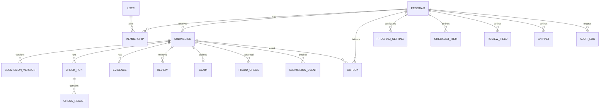

# 03 – Data model

## Conventions

- **SQLite** through the `wt` storage service. One database per app.
- **IDs** are text: `sub_...`, `rev_...`, `usr_...`, `prg_...`. Opaque, URL-safe, generated server-side.
- **Timestamps** are text in UTC ISO 8601 with milliseconds (`2026-11-03T14:05:00.000Z`). Use one helper; never store local time.
- **Time is integer seconds** with a `_seconds` suffix. Hours are formatting.
- **Money** is integer cents with a `_cents` suffix. Half Life owns the actual grant; Ire only displays and forwards.
- **JSON** is text validated by Go before write. Hot-path fields are normalised into columns; JSON is for snapshots and open-ended metadata.
- **Booleans** are integer 0/1.
- **Migrations** are versioned and checksummed through `store.Migrate`. Expand/contract only; never edit an applied migration.
- **Foreign keys** are on. `on delete cascade` for rows that belong to a submission; `restrict` for users/reviews that must survive.

## Entity relationship



## Core tables

### `program`

```sql
create table program (
    id                      text primary key,
    slug                    text not null unique,
    name                    text not null,
    timezone                text not null default 'UTC',
    active                  integer not null default 1,
    created_at              text not null,
    updated_at              text not null,
    outbound_url            text,
    outbound_enabled        integer not null default 1,
    signing_secret_last4    text,
    outbound_secret_last4   text,
    policy_version          integer not null default 1
);
```

One row per programme. `slug` is used in URLs and job payloads. `policy_version` increments when a policy row changes, so a review can record the policy it was decided under.

### `user`

```sql
create table user (
    id              text primary key,
    email           text not null unique,
    name            text,
    slack_id        text,
    avatar_url      text,
    created_at      text not null,
    last_login_at   text
);
```

The email is the HCA primary email, lowercased. `slack_id` is optional. No password hash: auth is HCA.

### `membership`

```sql
create table membership (
    id              text primary key,
    program_id      text not null references program(id) on delete cascade,
    user_id         text not null references user(id) on delete cascade,
    role            text not null check (role in ('admin','organizer','reviewer','auditor')),
    tracks          text not null default '["hardware"]',
    permissions     text not null default '[]',
    active          integer not null default 1,
    created_at      text not null,
    created_by      text references user(id) on delete set null,
    unique (program_id, user_id)
);
```

`tracks` and `permissions` are JSON arrays. Role is the primary gate; permissions are for future granularity (for example `VIEW_PII`, `MANAGE_CHECKS`). Do not let a permission silently widen a role; the authz layer reads both.

### `invite`

```sql
create table invite (
    id              text primary key,
    program_id      text not null references program(id) on delete cascade,
    email           text not null,
    role            text not null,
    tracks          text not null default '["hardware"]',
    created_at      text not null,
    created_by      text references user(id) on delete set null,
    accepted_at     text,
    accepted_by     text references user(id) on delete set null
);
```

An invite is a pre-authorised email. Signing in with HCA does not create a membership unless an invite matches or an admin creates one. This prevents a stranger with an HCA account from reading the queue.

### `session` and `oauth_state`

```sql
create table session (
    id              text primary key,          -- sha256 of the raw cookie token
    user_id         text not null references user(id) on delete cascade,
    expires_at      text not null,
    created_at      text not null,
    last_seen_at    text not null,
    user_agent      text,
    ip              text
);

create table oauth_state (
    state           text primary key,
    code_verifier   text not null,
    nonce            text not null,
    redirect_uri    text not null,
    expires_at      text not null,
    created_at      text not null
);
```

The raw session token never reaches the database. `oauth_state` is deleted on callback or expiry. `ip` and `user_agent` are for the audit log and session list, not analytics.

## Submissions

### `submission`

```sql
create table submission (
    id                      text primary key,
    program_id              text not null references program(id) on delete cascade,
    external_id             text not null,
    version                 integer not null default 1,

    status                  text not null,       -- checking, needs_attention, ready, claimed, in_review,
                                                 -- stage2_hold, fraud_pending, decided, withdrawn, reverted
    stage                   integer not null default 0,
    priority                integer not null default 0,
    held_reason             text,

    title                   text not null,
    description             text,
    track                   text not null default 'hardware',
    theme                   text,
    phase                   text,                -- design, build, warmup
    week                    integer,

    maker_email             text not null,
    maker_name              text,
    maker_slack_id          text,
    maker_hackatime_id      text,
    maker_user_id           text,                -- optional Half Life id, for self-review

    repo_url                text,
    demo_url                text,
    thumbnail_url           text,
    cover_url               text,

    requested_tier          integer,
    grant_cap_cents         integer,
    bom_total_cents         integer,

    hours_claimed_seconds   integer not null default 0,
    hours_journal_seconds   integer not null default 0,
    hours_hackatime_seconds integer not null default 0,
    hours_approved_seconds  integer,
    hours_adjustments       text,                -- JSON, set by the decision

    check_summary           text,                -- JSON: counts and overall status
    fraud_status            text,                -- null, pending, passed, failed, error, skipped
    current_review_id       text,
    previous_submission_id  text references submission(id) on delete set null,

    ingested_at             text not null,
    checks_ready_at         text,
    first_opened_at         text,
    decided_at              text,
    created_at              text not null,
    updated_at              text not null,

    unique (program_id, external_id, version)
);

create unique index submission_open_external_idx
    on submission(program_id, external_id)
    where status in ('checking','needs_attention','ready','claimed','in_review','stage2_hold','fraud_pending');

create index submission_queue_idx
    on submission(program_id, stage, status, priority desc, ingested_at asc, id);

create index submission_reviewed_idx
    on submission(program_id, decided_at desc);

create index submission_maker_idx
    on submission(program_id, maker_email);
```

`external_id` is Half Life's stable project/phase key (`<themeProjectId>:design`). `version` increments on each hand-in. The partial unique index enforces "one open ship per project/phase" at the database level. A new hand-in is refused while one is open; Half Life's existing `409 already_queued` handling can adopt the id.

`status` and `stage` are related but not redundant: `stage=2, status=stage2_hold` is a held decision; `stage=1, status=ready` is waiting for a reviewer. The UI always reads both.

`previous_submission_id` lets the review screen show the diff without a separate lookup. It is set at ingest when a prior version exists.

`check_summary` is a denormalised JSON summary for the queue (`{overall, pass, warn, fail, error, running}`). The full results are in `check_result`.

### `submission_version`

The immutable payload as received. This is what the reviewer judged, and what an audit reads later.

```sql
create table submission_version (
    submission_id   text not null references submission(id) on delete cascade,
    version         integer not null,
    payload         text not null,              -- raw JSON body, exactly as received
    payload_sha256  text not null,
    received_at     text not null,
    delivery_id     text,
    primary key (submission_id, version)
);

create unique index submission_version_delivery_idx
    on submission_version(delivery_id)
    where delivery_id is not null;
```

Storing the raw body lets the audit answer "what exactly did Half Life send?" without replaying a serializer. It is bounded by the ingest cap (1 MiB).

### `ingest_delivery`

```sql
create table ingest_delivery (
    delivery_id     text primary key,
    program_id      text not null references program(id) on delete cascade,
    external_id     text,
    version         integer,
    submission_id   text references submission(id) on delete set null,
    status          text not null,              -- accepted, duplicate, conflict, invalid, bad_signature
    http_status     integer not null,
    payload_sha256  text,
    received_at     text not null,
    processed_at    text
);
```

A retried ingest with the same delivery id returns the original result, not a second submission. This is the first line of idempotency.

## Evidence

Evidence is stored as typed rows where the review UI needs to sort/filter, and as JSON where it is a snapshot. Media is not stored; URLs point at Half Life's R2 or the provider.

### `journal_entry`

```sql
create table journal_entry (
    id              text primary key,
    submission_id   text not null references submission(id) on delete cascade,
    external_id     text,
    at              text not null,
    seconds         integer not null default 0,
    title           text,
    text            text,
    markdown        text,
    media           text,                       -- JSON array of {type,url,alt}
    timelapses      text,                       -- JSON array of {provider,externalId,url,thumbnailUrl,coveredSeconds}
    sort            integer not null default 0
);

create index journal_submission_idx on journal_entry(submission_id, at);
```

`seconds` is the journal claim net of any timelapse the ingest counts, exactly as Half Life's `journalMinutes` does. The review UI shows both the claim and the clip coverage.

### `commit_entry`

```sql
create table commit_entry (
    id              text primary key,
    submission_id   text not null references submission(id) on delete cascade,
    hash            text not null,
    message         text,
    author_name     text,
    author_email    text,
    committed_at    text not null,
    additions       integer not null default 0,
    deletions       integer not null default 0,
    coding_seconds  integer not null default 0,
    files_changed   integer not null default 0,
    co_authors      text,                       -- JSON array
    unique (submission_id, hash)
);

create index commit_submission_idx on commit_entry(submission_id, committed_at);
```

### `repo_snapshot`

```sql
create table repo_snapshot (
    submission_id   text primary key references submission(id) on delete cascade,
    forge           text not null,              -- github, gitlab, gitea, codeberg, unknown
    full_name       text not null,
    default_branch  text,
    head_sha        text,
    file_count      integer not null default 0,
    truncated       integer not null default 0,
    readme_text     text,
    readme_sha      text,
    tree            text,                       -- JSON array of paths, capped
    fetched_at      text not null,
    error           text
);
```

`tree` is capped (for example the first 2,000 paths, plus a flag if truncated). The checks only need presence by extension/pattern; the file browser can show the capped list and link to the forge for the rest.

### `hackatime_project`

```sql
create table hackatime_project (
    submission_id   text not null references submission(id) on delete cascade,
    project         text not null,
    seconds         integer,
    source          text not null,              -- live, cache, unavailable
    fetched_at      text not null,
    error           text,
    primary key (submission_id, project)
);
```

### `clip`

```sql
create table clip (
    id              text primary key,
    submission_id   text not null references submission(id) on delete cascade,
    provider        text not null,              -- lapse, r2, other
    external_id     text,
    at              text,
    length_seconds  integer not null default 0,
    covered_seconds integer not null default 0,
    url             text,
    thumbnail_url   text,
    note            text
);

create index clip_submission_idx on clip(submission_id, at);
```

`covered_seconds` is wall-clock time represented, not video runtime. `length_seconds` is the video's own length. Coverage is `covered / claimed`, clamped.

### `bom_line`

```sql
create table bom_line (
    id              text primary key,
    submission_id   text not null references submission(id) on delete cascade,
    name            text not null,
    purpose         text,
    quantity        integer not null default 1,
    unit_cost_cents integer not null default 0,
    vendor          text,
    link            text,
    sort            integer not null default 0
);
```

The design-week funding decision is priced from this list and the agreed tier. Ire does not trust the repo's CSV over the list Half Life sent; it displays both and flags disagreement.

## Checks

### `check_run`

```sql
create table check_run (
    id              text primary key,
    submission_id   text not null references submission(id) on delete cascade,
    version         integer not null,
    group_key       text not null,              -- repo, evidence, demo, fraud
    status          text not null,              -- running, done, error
    started_at      text not null,
    finished_at     text,
    error           text
);

create index check_run_submission_idx on check_run(submission_id, version, started_at desc);
```

The vertical slice keeps one row per submission version under a `(submission_id, version)` primary key, with `status`, `attempts`, `started_at`, `finished_at`, `error` and `runner_version`. That is enough for the queue badge and the job retry surface; the per-group `id`/`run_id` split waits until checks run as separate groups.

### `check_result`

```sql
create table check_result (
    id              text primary key,
    run_id          text not null references check_run(id) on delete cascade,
    submission_id   text not null references submission(id) on delete cascade,
    version         integer not null,
    check_key       text not null,              -- repo.public, readme.length, ...
    label           text not null,
    group_key       text not null,
    status          text not null,              -- pass, warn, fail, error, skip
    severity        text not null,              -- info, warn, block
    summary         text not null,
    detail          text,
    data            text,                       -- JSON, check-specific
    checked_at      text not null,
    duration_ms     integer not null default 0
);

create index check_result_latest_idx
    on check_result(submission_id, version, check_key, checked_at desc);
```

The latest result for a `(submission, version, check_key)` is the one the UI shows. Older results are kept so an audit can see a re-run. A re-run never deletes a result.

### `check_ack`

```sql
create table check_ack (
    id              text primary key,
    submission_id   text not null references submission(id) on delete cascade,
    version         integer not null,
    check_key       text not null,
    reviewer_id     text not null references user(id) on delete cascade,
    reason           text,
    created_at      text not null,
    unique (submission_id, version, check_key, reviewer_id)
);
```

An acknowledgement is a reviewer saying "I saw this warning and I am deciding anyway". It is per version, so a resubmission requires a fresh acknowledgement.

### `check_policy`

```sql
create table check_policy (
    program_id          text not null references program(id) on delete cascade,
    check_key           text not null,
    tracks              text not null default '["hardware"]',
    phases              text not null default '["design","build"]',
    block_ingest        integer not null default 0,
    block_approval      integer not null default 0,
    required_for_review integer not null default 1,
    primary key (program_id, check_key)
);
```

`required_for_review` means the ship waits in `checking` until the check has a result. `block_approval` means an approval is refused until the result is pass/warn/acknowledged. `block_ingest` is used sparingly; it keeps a ship out of the stage 1 queue and puts it in `needs_attention`.

## Reviews and claims

### `claim`

```sql
create table claim (
    submission_id   text primary key references submission(id) on delete cascade,
    reviewer_id     text not null references user(id) on delete cascade,
    stage           integer not null,
    expires_at      text not null,
    heartbeat_at    text not null,
    created_at      text not null
);

create index claim_expiry_idx on claim(expires_at);
create index claim_reviewer_idx on claim(reviewer_id);
```

`submission_id` as the primary key makes claiming a single insert that either succeeds or collides. Never implement claiming as read-then-write. Expired claims are deleted opportunistically and by `/jobs/tick`.

### `review`

```sql
create table review (
    id                      text primary key,
    submission_id           text not null references submission(id) on delete cascade,
    version                 integer not null,
    stage                   integer not null,

    reviewer_id             text references user(id) on delete set null,
    reviewer_email          text not null,
    reviewer_name           text,
    reviewer_role           text not null,

    decision                text not null check (decision in ('approved','changes','rejected')),
    note_to_maker           text not null default '',
    internal_note           text,

    hours_approved_seconds  integer,
    hours_adjustments       text,                -- JSON: per-source and per-entry
    tier_override           integer,
    grant_override_cents    integer,

    fields                  text,                -- JSON: custom fields
    checklist               text,                -- JSON: ticked items
    acknowledgements        text,                -- JSON: check keys acknowledged
    policy_version          integer not null,

    held                    integer not null default 0,
    held_reason             text,
    is_final                integer not null default 1,
    supersedes_review_id    text references review(id) on delete set null,
    invalidated_at          text,
    invalidated_by          text references user(id) on delete set null,
    invalidation_reason     text,

    idempotency_key         text,
    created_at              text not null,

    unique (submission_id, idempotency_key)
);

create unique index review_final_idx
    on review(submission_id)
    where is_final = 1 and invalidated_at is null;

create index review_submission_idx on review(submission_id, created_at desc);
create index review_reviewer_idx on review(reviewer_id, created_at desc);
```

Rules:

- A stage 1 decision that is not held writes `held=0, is_final=1`.
- A stage 1 decision that is held writes `held=1, is_final=0, held_reason=...`.
- A stage 2 confirm/override writes a new row with `stage=2, is_final=1, supersedes_review_id=<stage1 review>`.
- A stage 2 send-back invalidates the stage 1 held row and returns the ship to stage 1.
- A revert/requeue invalidates the final row (`invalidated_at`, reason).
- Reviews are never updated for content. Only the invalidation columns change.
- `idempotency_key` is client-supplied (or derived) and unique per submission. A retried decision returns the existing review.

The partial unique index is the load-bearing invariant: a submission can have at most one live final review.

### `draft`

```sql
create table draft (
    submission_id   text not null references submission(id) on delete cascade,
    reviewer_id     text not null references user(id) on delete cascade,
    stage           integer not null,
    note            text not null default '',
    internal_note   text not null default '',
    values          text not null default '{}',
    checklist       text not null default '[]',
    adjustments     text not null default '{}',
    updated_at      text not null,
    primary key (submission_id, reviewer_id)
);
```

Drafts are server-side so a refresh or another device does not lose typing. Autosave is debounced; a decision deletes the draft in the same transaction.

## Fraud

```sql
create table fraud_check (
    id              text primary key,
    submission_id   text not null references submission(id) on delete cascade,
    version         integer not null,
    stage           integer not null check (stage = 2),
    provider        text not null,
    status          text not null,              -- pending, passed, failed, error, skipped
    score           integer,
    verdict         text,
    summary         text,
    details         text,                       -- JSON, no private thresholds
    external_id     text,
    requested_at    text not null,
    completed_at    text,
    error           text
);

create index fraud_submission_idx on fraud_check(submission_id, requested_at desc);
```

The `stage = 2` check is intentional. A stage 1 fraud row is a bug, not a feature. The provider is external; `details` is whatever the provider is willing to expose to an organiser (score and plain-language reasons), never private rules.

## Timeline, audit and config

### `submission_event`

```sql
create table submission_event (
    id              text primary key,
    submission_id   text not null references submission(id) on delete cascade,
    kind            text not null,              -- ingested, checks_ready, claimed, released, held, decided,
                                                -- delivered, delivery_failed, fraud, reverted, requeued, withdrawn
    actor_id        text references user(id) on delete set null,
    actor_email     text,
    data            text,                       -- JSON: before/after, reason, check counts
    created_at      text not null
);

create index submission_event_idx on submission_event(submission_id, created_at);
```

This is the fast timeline for the review screen and the status API. It is written in the same transaction as the state change.

### `audit_log`

```sql
create table audit_log (
    id              text primary key,
    program_id      text not null references program(id) on delete cascade,
    actor_id        text references user(id) on delete set null,
    actor_email     text,
    actor_ip        text,
    actor_user_agent text,
    action          text not null,
    target_type     text,
    target_id       text,
    before_json     text,
    after_json      text,
    reason          text,
    request_id      text,
    created_at      text not null
);

create index audit_program_idx on audit_log(program_id, created_at desc);
create index audit_target_idx on audit_log(target_id, created_at desc);
create index audit_action_idx on audit_log(action, created_at desc);
```

Append-only. No update/delete route. Admin/auditor read only. This is the record of who changed what, including policy edits, member changes, overrides and secret rotations (last-4 only).

### `program_setting`

```sql
create table program_setting (
    program_id      text not null references program(id) on delete cascade,
    key             text not null,
    value           text not null,              -- JSON
    updated_at      text not null,
    updated_by      text references user(id) on delete set null,
    primary key (program_id, key)
);
```

Typed Go structs decode this into `ProgramPolicy`. Validation happens on write; a stored value that no longer parses is a startup error, not a silent default. `policy_version` on `program` increments on every write.

### `checklist_item`, `review_field`, `snippet`

```sql
create table checklist_item (
    id              text primary key,
    program_id      text not null references program(id) on delete cascade,
    label           text not null,
    tracks          text not null default '["hardware"]',
    stage           integer not null default 1,
    required        integer not null default 0,
    sort            integer not null default 0
);

create table review_field (
    id              text primary key,
    program_id      text not null references program(id) on delete cascade,
    key             text not null,
    label           text not null,
    type            text not null,              -- checkbox, text, number, select, multiselect
    description     text,
    options         text,                       -- JSON array
    required        integer not null default 0,
    tracks          text not null default '["hardware"]',
    stage           integer not null default 1,
    sort            integer not null default 0,
    unique (program_id, key)
);

create table snippet (
    id              text primary key,
    program_id      text not null references program(id) on delete cascade,
    name            text not null,
    body            text not null,
    stage           integer not null default 1,
    unique (program_id, name)
);
```

Forms are stage-scoped. Stage 1 defaults to no checklist and no custom fields; stage 2 can require them. A review stores the values it used, so editing a form later never rewrites history.

## Outbox and delivery

```sql
create table outbox (
    id              text primary key,
    program_id      text not null references program(id) on delete cascade,
    submission_id   text references submission(id) on delete set null,
    event           text not null,              -- review.approved, review.changes, review.rejected,
                                                -- review.fraud, review.reverted, review.requeued, ship.updated
    dedupe_key      text not null unique,       -- decision:<review_id>, fraud:<fraud_id>, ...
    payload         text not null,              -- exact JSON body to send
    url             text not null,
    status          text not null,              -- pending, sending, delivered, failed
    attempts        integer not null default 0,
    next_attempt_at text not null,
    last_http_status integer,
    last_error      text,
    created_at      text not null,
    delivered_at    text
);

create index outbox_due_idx on outbox(status, next_attempt_at);
create index outbox_submission_idx on outbox(submission_id, created_at);
```

`dedupe_key` is the idempotency guarantee: a retried decision cannot create a second delivery for the same review. `payload` is stored before send, so a restart or an operator can inspect exactly what was sent. The outbox row is written in the decision transaction; the job only sends it.

The vertical slice uses `packages/v2/outbox` with its `webhook_outbox` table. That table adds `headers`, `metadata`, `max_attempts` and `lease_until`; `program_id` and `submission_id` live in `metadata`. The older `outbox` table is migrated once on startup and then left read-only.

## Counters

```sql
create table program_counter (
    program_id      text not null references program(id) on delete cascade,
    key             text not null,              -- queue:1:ready, queue:2:stage2_hold, ...
    value           integer not null default 0,
    updated_at      text not null,
    primary key (program_id, key)
);
```

Counters are maintained in the same transaction as a status change, and rebuilt by `/jobs/tick` (or a manual admin action) once a day. They power the queue badges without a `COUNT(*)` on every page. If a counter ever disagrees with the rows, the rebuild is the repair.

## Hot queries

### Queue page

```sql
select id, external_id, version, status, stage, priority, title, theme, phase, week,
       maker_name, hours_claimed_seconds, check_summary, ingested_at, held_reason
from submission
where program_id = ?
  and stage = ?
  and status in ('ready','claimed','in_review','needs_attention','stage2_hold','fraud_pending')
order by priority desc, ingested_at asc, id asc
limit ?;
```

Covered by `submission_queue_idx`. A keyset cursor uses `(priority, ingested_at, id)`.

### Ire bundle

One query for the submission, one for checks (latest per key), one for journals, one for commits, one for clips, one for BOM, one for prior reviews. Seven indexed reads on one submission, not N+1. The handler assembles the DTO and caps each array.

### Outbox due

```sql
select id, payload, url, attempts
from outbox
where status = 'pending' and next_attempt_at <= ?
order by next_attempt_at asc
limit 20;
```

Covered by `outbox_due_idx`. A compare-and-set updates `status='sending'` before sending.

### Latest check results

```sql
select check_key, label, group_key, status, severity, summary, detail, checked_at
from check_result
where submission_id = ? and version = ?
  and id in (
    select id from check_result
    where submission_id = ? and version = ?
    group by check_key
    having checked_at = max(checked_at)
  )
order by group_key, check_key;
```

If SQLite's planner dislikes the correlated form, use a `latest_check` view or a `check_latest` table updated on write. The plan prefers the view/table if the query is not comfortably under the 5s limit; it will be tiny in practice.

## Retention and archival

- Open submissions: as long as the programme is active.
- Decided submissions: season plus a configured retention window (for example 12 months).
- Audit log: longer, because it is the record of decisions; keep actor ids and action, drop maker PII after the retention window.
- Raw payloads: same as the submission; they are the evidence snapshot.
- Sessions: delete expired on tick.
- Outbox: keep delivered rows for 90 days, then delete; failed rows until an operator resolves them.
- Check results: keep the latest per version for the life of the submission; older re-runs can be pruned after 90 days.
- Media: not stored. If reviewer attachments are added, store blob digests and delete with the review.

A `retention` job in `/jobs/tick` performs the deletions in bounded batches and writes an audit row with counts. Never delete in an unbounded transaction.

## Migration strategy

1. Add new tables/columns in one release.
2. Dual-write or backfill in a job.
3. Switch reads.
4. Remove the old shape in a later release, after every deploy that reads it is gone.

Rules:

- Never edit an applied migration; the storage service checksums it.
- Use `store.Migrate(ctx, version, statements...)` with the next integer version.
- Test the migration on a copy of production data, not just an empty DB.
- Back up before a destructive migration; `wt backup create review`.
- A code rollback must be able to read the newer schema. If it cannot, restore the backup with the rollback.
- Migration statements are capped by SQL/time limits; a large backfill belongs in a job, not in `/_wt/migrate`.

## Sizing

A season of 1,000 makers with 10 submissions each is 10,000 submissions. Each submission has perhaps 200 journal entries, 200 commits, 100 files, 50 clips, 20 check results. That is millions of rows, but text-heavy and small. SQLite handles it with the indexes above. The 512 MB `disk_mb` starting point is conservative; measure and raise if needed. Media is not stored, which is the difference between megabytes and terabytes.
