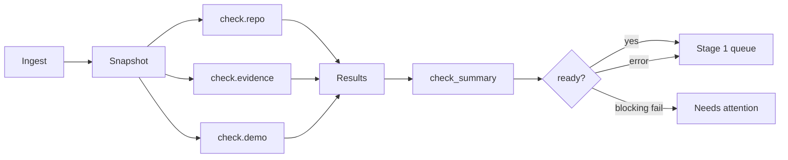

# 04 – Automatic checks

The checks are the reason reviewers trust Ari. This plan keeps them, makes them legible, and separates "the check failed" from "the check could not run". A check is evidence for a human, not a verdict.

## Principles

1. **Port, don't reinvent.** `ari-webhooks` already has working Go clients for forges, Hackatime, Lapse and demo probes. Half Life already has the hardware theme policy and BOM/design rules. Move that logic behind one interface; do not write a second, weaker implementation.
2. **A check is a snapshot.** It is tied to a submission version and a time. Re-running creates a new result; it never rewrites the result the reviewer saw.
3. **Error is not fail.** A timeout, rate limit or private repo is "could not check", not "the maker did something wrong". A failed demo probe after the full retry window can be a fail; a single 404 five seconds after submit cannot.
4. **Warnings are not blockers by default.** A missing recommended file is a warning. A private repo, missing README, or missing required design file can block approval. The programme decides which.
5. **Blocking failures go to a human.** A blocking check failure moves the ship to `needs_attention`, not an auto-reject. A reviewer can send it back, reject it, or waive it with a reason if the check is wrong.
6. **No private logic in this repo.** Fraud and any AI screening live behind a provider interface, called only at stage 2.
7. **Cheap first, deep later.** Repo checks finish in seconds and unblock the queue. Hackatime, Lapse and demo checks can continue; the ship is reviewable with the results that matter for approval.

## Lifecycle



- **Ingest** validates and writes the snapshot, then enqueues check groups.
- **`check.repo`** fetches the forge tree and README, detects file kinds and the BOM table, and reads design JSON if needed.
- **`check.evidence`** fetches Hackatime time and validates the journal/clip data the ingest sent.
- **`check.demo`** probes the demo URL with retries.
- **`check.fraud`** is only enqueued when a submission enters stage 2 and policy requires it.
- **`/jobs/tick`** requeues stale/missing checks, sweeps expired claims, drains the outbox and rebuilds counters.

Each group is a separate job so one slow external API cannot hold the others, and so a retry does not redo the fast work.

## Check catalogue

The keys are stable; the UI, policy and audit refer to them.

| Key | Group | Source | Default severity | What it asks |
| --- | --- | --- | --- | --- |
| `repo.public` | repo | forge | block | Is the repo public and readable? |
| `repo.tree` | repo | forge | block | Did the default branch return a file tree? |
| `repo.readme.exists` | repo | forge | block | Is there a README? |
| `repo.readme.length` | repo | forge | block | At least 200 characters, 3 lines? |
| `repo.readme.images` | repo | forge | warn | At least 2 images? |
| `repo.readme.bom_table` | repo | forge | warn/block by theme | Is there a readable BOM table? |
| `repo.files.required` | repo | forge | block by theme | Are the week's required file kinds present? |
| `repo.files.recommended` | repo | forge | warn | Are the recommended file kinds present? |
| `repo.design_json` | repo | forge | info | Does a `.json` file identify as an EasyEDA/PCB design? |
| `repo.commits.present` | commits | forge | warn | Is there commit history in the evidence window? |
| `repo.commits.authorship` | commits | forge | warn | Do commit authors match the maker? |
| `repo.commits.spread` | commits | forge | info | Are commits spread over time, not one dump? |
| `repo.commits.after_submit` | commits | forge | info | Are there commits after the hand-in? |
| `journal.present` | evidence | ingest | block | Is there at least one journal entry? |
| `journal.hours` | evidence | ingest | warn | Do journal claims add up to the phase minimum? |
| `journal.wordless` | evidence | ingest | warn | Is an entry only a clip with no words? |
| `hackatime.linked` | evidence | ingest | warn | Are Hackatime projects linked? |
| `hackatime.time` | evidence | Hackatime | warn | How much tracked time is in the window? |
| `hackatime.stale` | evidence | Hackatime | block approval | Could the live time be refreshed? |
| `hackatime.overlap` | evidence | Hackatime | info | Is tracked time already covered by a timelapse? |
| `lapse.clips` | evidence | ingest/Lapse | info | Are there clips? |
| `lapse.coverage` | evidence | Lapse | warn | What share of claimed time is covered by footage? |
| `demo.reachable` | demo | probe | warn/block by track | Is the demo live? |
| `identity.verified` | identity | ingest/HCA | warn | Is the maker's identity verified? |
| `duplicate.repo` | duplicate | local | warn | Is this repo used by another open/approved ship? |
| `duplicate.evidence` | duplicate | local | warn | Are hours/entries reused from another ship? |
| `duplicate.text` | duplicate | local | warn | Is the description copied from another project? |
| `prior.review` | history | local | info | What did earlier decisions say? |
| `resubmission.diff` | history | local | info | What changed since the last version? |
| `fraud.provider` | fraud | external | hold | Stage 2 only; provider verdict |

### What blocks what

- `block_ingest`: the ship does not enter stage 1. It goes to `needs_attention`. Use for private/missing repos and missing README only.
- `block_approval`: the ship can be reviewed, but approve is disabled until the check is pass/warn or acknowledged. Use for required file kinds, missing journal, stale Hackatime without an override.
- `required_for_review`: the ship stays `checking` until this result exists. Use for repo and journal checks. Do not use for slow optional checks.
- `warn`: visible, acknowledgeable, never blocks by default.
- `info`: context only; never blocks.

The programme can change these per check, per track and per phase. The defaults above are the Half Life hardware policy.

## Theme policy

Half Life's `src/lib/config/repo-checks.ts` is the source of truth for what each hardware week needs. Port the table, not the code shape.

| Theme | Required | Recommended | BOM table |
| --- | --- | --- | --- |
| PCB | `pcbSource`, `bom` (CSV) | `pcbFab`, `firmware` | 2 rows |
| CAD | `cadSource` | `cadModel` | 1 row |
| SYNTH | `logicSchematic` | `firmware` | – |
| DISPLAYS | `firmware` (waivable) | `logicSchematic` | – |
| BREADBOARD_COMPUTER / freestyle | none | `pcbSource`, `cadSource`, `firmware` | – |
| WARMUP | none | none | – |

File kinds:

- `pcbSource`: `.kicad_pcb`, `.kicad_sch`, `.kicad_pro`, `.brd`, `.sch`, `.pcbdoc`, `.schdoc`, `.fzz`, `.fzpz`, `.epcb`, `.epro`, `.epro2`, `.eprj`, `.esch`, or a design `.json`.
- `pcbFab`: Gerber/drill extensions or a `.zip`.
- `cadSource`: `.f3d`, `.f3z`, `.step`, `.stp`, `.fcstd`, `.sldprt`, `.sldasm`, `.iges`, `.igs`. Tinkercad, OpenSCAD, Blender and STL-only do not count as source.
- `cadModel`: `.stl`, `.obj`, `.3mf`.
- `firmware`: `.ino`, `.c`, `.cc`, `.cpp`, `.cxx`, `.h`, `.hh`, `.hpp`, `.py`, `.mpy`, `.rs`, `.ts`, `.js`, `.uf2`, `.hex`, `.bin`, `.go`.
- `logicSchematic`: `.kicad_sch`, `.kicad_pro`, `.kicad_pcb`, `.sch`, `.schdoc`, `.esch`, `.fzz`, `.circ`, `.dig`, or a design `.json`.
- `bom`: a `bom*.csv` (pattern `/(^|\/)[^/]*bom[^/]*\.csv$/i`).

Preserve the hard-won details:

- A `.json` only counts as a design if its opening says so. EasyEDA Standard writes a numeric `docType` (1 schematic, 3 board, 5 project); Pro writes `PCB`, `SCH`, `SCH_PAGE`, `BOARD`. A bare number must be accompanied by `editorVersion` or `canvas`.
- README BOM tables must have a part-like column and a price/link/supplier column. A pinout or controls table is not a BOM. Markdown and HTML tables both count; fenced code does not.
- A private repo must read as not-found, even if the server token can see it. Otherwise anyone can link someone else's private repo and have the server read its contents.
- A truncated tree is not proof a file is missing; report `warn` with "tree truncated", not `fail`.
- The Displays firmware requirement is waivable only when the maker confirms there is no microcontroller and firmware is the only blocking failure.

## Two gates, one policy

Half Life already has a submit gate (`submitPhase` re-runs `checkRepo`) and Ire has review-time checks. They are not the same gate:

- Half Life's gate decides whether a maker may hand work in. It should stay strict and fast, because the maker can fix a blocking issue before a reviewer sees it.
- Ire's gate decides whether a reviewer may approve. It catches drift: a repo that changed after submit, a README edited, a file deleted, a Hackatime project renamed.

Both should use the same theme requirement table. To prevent drift:

- Keep the canonical hardware requirement table in a generated JSON fixture checked into both repositories (or a versioned `policy.json` with a checksum).
- Half Life's `verify:contracts` pins the fixture; Ire's contract tests pin the same fixture.
- A requirement change is a two-repository change with the same fixture hash. If only one side changes, the fixture mismatch fails CI.

Where the two disagree at review time, Ire's result is what the reviewer sees, and the reviewer can waive it with a reason. Do not silently ignore a review-time failure because the submit gate passed.

## Check details

### Repository

Fetch in parallel:

- repo metadata / visibility;
- default-branch tree (recursive);
- README (raw or rendered, depending on forge).

For GitHub, `GET /repos/{owner}/{repo}/git/trees/HEAD?recursive=1` and `GET /repos/{owner}/{repo}/readme`. For GitLab, the equivalent project repository tree and README. Use a token if configured; respect `ETag`/`If-None-Match`; cache by `(forge, full_name, head_sha)` for 60 seconds, and "unavailable" for 10 seconds.

Do not fetch every `.json` file. Only open the five shallowest plausible candidates, skip `node_modules`, `dist`, `build`, `out`, `coverage`, `vendor`, `.next`, lockfiles. A design JSON is usually at the repo root or one directory down.

### README

- Strip fenced code before looking for tables.
- Count characters and lines after trimming.
- Images: Markdown `` or HTML ``; count unique `src` values, ignore tracking pixels? Keep it simple: count HTTP(S) URLs with an image extension or an `` tag.
- BOM table: parse Markdown and HTML; require header + separator + at least `minRows` data rows; part-like and price-like columns.
- Report the line number/label of the table so the reviewer can jump to it.

### Commits

- Window: from the programme's `trackingStartsAt` or the previous approved ship to the submission's `receivedAt`. The ingest payload carries the window; the forge API filters by `since`/`until`.
- Count commits, authors, first/last date, additions/deletions.
- Authorship: compare commit `author.email` to the maker's HCA email and known GitHub noreply forms. A mismatch is a warning, not a fail; people commit from a personal machine with a different address.
- Co-authors: parse `Co-authored-by` trailers; show them, do not gate on them.
- Spread: number of distinct days with commits; a single dump is context, not proof of fraud.
- After-submit commits: informational; a maker may push a fix after handing in.

### Hackatime

- Use the maker's Hackatime id from ingest. If absent, do not guess from email; report `skip` with "no Hackatime id".
- Fetch per-project seconds in the phase window. The window is the programme week for the theme/phase, or all-time for a warm-up.
- Cache per `(hackatime_user, project, window)` for 5 minutes.
- If the fetch fails, return `error` with `stale=true`; do not return `0`.
- If a reviewer has set an explicit hours override, the stale check is satisfied for that source; the approval can proceed.
- Overlap: if a journal entry has a timelapse under the same Hackatime project, the tracked time and the clip describe the same sitting. Report the overlap and do not double-count in the displayed total. This is evidence, not a silent subtraction; the UI explains it.

### Lapse and timelapse

- Ingest carries the clip URLs, `covered_seconds`, `length_seconds`, provider and Hackatime project.
- Coverage is `sum(covered_seconds) / claimed_seconds`, clamped to `[0,1]`.
- A low coverage is a warning, not a fail. A 2-hour session with a 30-second clip is suspicious; a 2-hour session with a 1-hour timelapse is normal.
- The video runtime is not the credited time. Show both.
- Broken clip URLs are `error`, not `fail`.

### Demo

- Hardware projects may omit a demo. If present, probe it.
- First attempt at ingest + 5s; retries at +30s, +2m, +10m. A 404 immediately after submit is usually a deploy propagating.
- A 401/403/429 is "blocked, alive"; leave it for a human. Never auto-reject a bot-walled demo.
- Known bot-walled hosts (Printables, Steam Community) are not probed; show the link.
- A dead demo after the full window can be a blocking warning depending on track; Half Life hardware defaults to warning, not block.
- SSRF rules apply: public IPs only, HTTPS only, redirects re-checked.

### Identity

- Ingest carries the maker's verification status from Half Life/HCA.
- Ire does not collect documents. It shows `verified` / `not verified` / `unknown`.
- A non-verified maker is a warning at review time; Half Life already enforces verification at payout. Do not duplicate the payout gate.

### Duplicates

- Same repo used by another open or approved submission: warning with a link.
- Same evidence (journal text, clip URL, commit hash) reused: warning.
- Same description (normalised) across projects: warning.
- Same maker with overlapping time windows across phases: warning.
- These are signals for a reviewer, not automatic rejection. Fraud policy can treat them as a trigger for stage 2.

### Fraud

See [Fraud provider](#fraud-provider). Fraud is not a repo check; it is a stage 2 gate.

## Porting map

| New package | Source | What to take |
| --- | --- | --- |
| `checks/forge` | `ari-webhooks/internal/integrations/githost` | GitHub/GitLab clients, auth, rate limits, tree/README |
| `checks/repo` | `halflife/src/lib/repo-checks.ts`, `repo.ts`, `repo-ref.ts`, `forge.ts` | visibility, README, file kinds, BOM table, design JSON, theme table |
| `checks/commits` | `ari-webhooks/internal/pipeline/enrich` (GitHub commit capture) | commit list, author matching, coding seconds |
| `checks/hackatime` | `ari-webhooks/internal/integrations/hackatime`, `halflife/src/lib/hackatime.ts` | project seconds, spans, window, stale |
| `checks/lapse` | `ari-webhooks/internal/integrations/lapse`, `halflife/src/lib/lapse-timelapses.ts` | clip list, covered seconds, URLs |
| `checks/demo` | `ari-webhooks/internal/integrations/probe`, `autocheck` | retries, bot-wall handling, SSRF |
| `checks/filehours` | `ari-webhooks/internal/filehours` | file-level coding time, if kept |
| `checks/evidence` | `halflife/src/lib/hours.ts`, `hours-overlap.ts` | additive journal/Hackatime, timelapse coverage, overlap |
| `checks/policy` | `halflife/src/lib/config/repo-checks.ts` | theme requirements and BOM rules |

Do not port:

- Ari's Postgres schema and SQL.
- Ari's `ari` web app UI.
- Ari's private fraud/AI code.
- Ari's minute/second dual-write columns. Use seconds only.

## Interface

Keep the check package free of HTTP handlers and database calls.

```go
type Status string

const (
    Pass  Status = "pass"
    Warn  Status = "warn"
    Fail  Status = "fail"
    Error Status = "error"
    Skip  Status = "skip"
)

type Result struct {
    Key       string
    Label     string
    Group     string
    Status    Status
    Severity  string // info, warn, block
    Summary   string
    Detail    string
    Data      any
    CheckedAt time.Time
    Duration  time.Duration
}

type Input struct {
    Submission Snapshot
    Version    int
    Repo       *Repo
    Journal    []JournalEntry
    Links      []HackatimeProject
    Clips      []Clip
    Policy     Policy
    HTTP       *http.Client
    Now        time.Time
}

type Check interface {
    Key() string
    Group() string
    Run(ctx context.Context, in Input) (Result, error)
}
```

The runner:

```go
type Runner struct {
    Checks  []Check
    Timeout time.Duration
    Workers int
}

func (r *Runner) Run(ctx context.Context, in Input) ([]Result, error)
```

- Run checks in a bounded worker pool (4-8).
- Each check gets a context with its own timeout (10s default, 30s for the repo group).
- A check that panics becomes an `error` result with the panic message, not a 500 for the whole group.
- The runner writes one `check_run` and N `check_result` rows in a transaction after all checks finish (or streams results as they complete; either way, the summary is computed once).

## Policy

```go
type CheckPolicy struct {
    Key               string
    Tracks            []string
    Phases            []string
    BlockIngest       bool
    BlockApproval     bool
    RequiredForReview bool
}
```

Helper functions:

```go
func Overall(results []Result) Summary
func CanEnterQueue(results []Result, policy []CheckPolicy) (bool, string)
func CanApprove(results []Result, acks map[string]bool, policy []CheckPolicy) []Problem
```

`Overall` rules:

- any `fail` with `severity=block` → `blocked`;
- any `error` → `warn` unless `block_approval`, in which case `needs_ack`;
- any `warn` → `warn`;
- otherwise `pass`.

`CanApprove` returns field-level problems the UI can show and the server can enforce. A warning with no acknowledgement is a problem only if `policy.require_warning_ack` is on (default on). A blocking fail is always a problem unless an admin waiver exists (which is audited).

## Job orchestration

### `check.repo`

Payload: `{submission_id, version, force?}`.

1. Load the submission and snapshot. If version is not current, no-op.
2. Fetch the forge snapshot.
3. Run repo checks.
4. Write results and summary.
5. If the submission was `checking` and the required repo checks are done, set `ready` (or `needs_attention`).
6. Publish `queue` event.

### `check.evidence`

Payload: `{submission_id, version, force?}`.

1. Load the submission, journal and links.
2. Fetch Hackatime per project; validate clips.
3. Write results.
4. Update summary; if required checks are done, set `ready`.
5. Publish.

### `check.demo`

Payload: `{submission_id, version, attempt}`.

- If no demo, write `skip` and finish.
- Probe; on failure before the last attempt, re-enqueue with `run_at = now + delay[attempt]`.
- On the last attempt, write `warn`/`fail` per policy.

### `check.fraud`

Only enqueued when the submission enters stage 2 and policy requires fraud.

- Refuse if `stage != 2` (defence in depth).
- Insert `fraud_check` pending.
- Call the provider with a timeout.
- Write passed/failed/error; publish; update submission `fraud_status`.
- A failure writes a `review.fraud` outbox event if policy says to flag.

### Re-runs

A reviewer or admin can re-run a group:

- `POST /api/v1/submissions/{id}/checks/{group}/rerun`.
- Rate-limited (one per group per minute per submission).
- Writes a new `check_run`; old results remain.
- Does not change the submission version.

## Caching and rate limits

- Forge snapshot: 60s per repo/branch; 10s for "unavailable". Key by `forge/full_name/head_sha` once known.
- Hackatime: 5 minutes per `(user, project, window)`.
- Lapse: 5 minutes per clip/project.
- Demo: no cache; retries are the cache.
- Provider: no cache; idempotency key per `(submission, version, stage)`.
- GitHub unauthenticated: 60 requests/hour. Use a token; 5,000/hour. If no token, degrade to `error` with a clear message, not repeated 403s.
- On 429, respect `Retry-After`; on 5xx, exponential backoff with jitter.
- Never retry a 4xx except 408/425/429.
- Cap redirects at 2; cap response body at 2 MiB; 10s timeout.

## Reviewer presentation

The preflight strip is the product surface of all this work. It must be readable in one glance.

```text
┌ Preflight ────────────────────────────────────────────────┐
│ ✓ Public repo         ✓ README 4.2k chars, 6 images       │
│ ✓ Required files      ✓ BOM table (7 rows)                │
│ ✓ Commits 14 over 5d  ⚠ 2 commits from another email      │
│ ✓ Hackatime 12.3h     ⚠ Timelapse coverage 18%            │
│ ✓ Identity verified   · Demo not provided                 │
│ [Show details]                                            │
└───────────────────────────────────────────────────────────┘
```

Rules:

- One line per check, grouped by source. Green check, amber warning, red block, grey skip/error.
- The summary line says what was found, not just "pass": "README 4.2k chars, 6 images" is more useful than "README OK".
- Clicking a line expands the detail and the raw data (file list, commit list, timing).
- A warning that blocks approval says so on the line and in the disabled approve tooltip.
- A check that could not run says "Could not check: GitHub rate limit" and does not pretend to pass.
- The review bundle includes the latest results and the `check_summary`; the UI does not fetch checks separately.
- Re-run is a small action in the detail, not a primary button.

### Acknowledgement

If a warning requires acknowledgement, the decision payload includes the keys. The server validates them against the latest results for the version. An acknowledgement is per reviewer, per version; it is not a global waiver. The UI shows a single "I've read these warnings" checkbox for all warnings, and records each key.

## Testing and parity

### Fixtures

- Repo snapshots: public repo with README/BOM, private repo, 404, empty repo, truncated tree, EasyEDA JSON, a repo whose "PCB file" is `package.json`.
- README: Markdown table, HTML table, fenced code table, pinout table, no table, 1-row/2-row BOM.
- Commits: author match, mismatch, co-author, one-day dump, no commits.
- Hackatime: normal, stale, zero, public-stats-off, overlap with a clip.
- Lapse: covered > runtime, broken URL, no clips.
- Demo: 200, 404 after retries, 403 bot wall, printable/steam, redirect to private IP.
- Duplicate: same repo, same clip, same description.

### Parity harness

Before cutover, run the new checks over a sample of real Ari ships and compare:

- same file kinds found?
- same README/BOM conclusion?
- same Hackatime seconds (within a minute)?
- same demo verdict?
- same overall pass/warn/fail?

Every difference is either a bug or an intentional policy change. Record it. Do not declare parity "close enough" without the list.

### Unit and integration tests

- Every check has a table-driven test with fixtures.
- The runner test proves a panic/timeout becomes an `error` result, not a failed group.
- The job test proves an old version is a no-op and a re-run creates a new result.
- The policy test proves `block_ingest`, `block_approval` and `required_for_review` are enforced server-side, not just in the UI.
- The SSRF test proves private IPs, redirects and non-HTTPS are refused.

## Fraud provider

Fraud is a separate interface because its rules are private and its failure mode is different.

```go
type FraudProvider interface {
    Check(ctx context.Context, req FraudRequest) (FraudResult, error)
}

type FraudRequest struct {
    SubmissionID string
    Version      int
    Stage        int // must be 2
    Maker        Maker
    Project      Project
    Evidence     FraudEvidence // links, counts, check summary
}

type FraudResult struct {
    Verdict   string // passed, failed, needs_review
    Score     int    // 1-10, higher is better
    Summary   string
    Details   any
    ExternalID string
}
```

Rules:

- The provider is called only from `check.fraud`, which refuses `stage != 2`.
- The request contains the minimum evidence; do not send private repo contents or identity documents.
- The response is stored as a generic verdict + summary; private rules stay at the provider.
- Timeout 15s; one retry on 5xx/timeout; idempotency key `fraud:<submission>:<version>:<stage>`.
- If the provider returns `failed`, the outbound `review.fraud` event carries `verdict`, `checks` (a generic list) and the flag; Half Life applies the maker flag.
- If the provider errors, policy decides: `hold` (default), `retry`, or `allow_organizer_override`. Never auto-approve on an error.
- A disabled provider returns `skipped`. No network call.
- The public repo contains a `disabled` implementation and a `fake` implementation for tests. It never contains detection prompts or thresholds.

## What not to do

- Do not auto-reject on a repo check failure. Put it in `needs_attention`.
- Do not call GitHub for every page view. Checks are precomputed.
- Do not use the repo's BOM CSV as the funding list without showing both and flagging a mismatch.
- Do not treat a missing Hackatime id as zero hours. Show "not linked".
- Do not count timelapse runtime as hours. It is coverage.
- Do not run fraud at stage 1 "just in case". The policy and the code both forbid it.
- Do not hide a check error behind a green tick.

## Implemented keys

The prototype emits the keys below. `Severity` is the worst severity the key can carry; only `block` disables approval, and only when the status is `fail` or `error`. A `warn` status asks the reviewer to acknowledge it; `skip` and `info` never block.

| Key | Group | Source | Severity | Blocks | State |
| --- | --- | --- | --- | --- | --- |
| `repo.accessible` | repo | forge, payload | block | approval | live |
| `repo.description` | repo | payload | warn | no | live |
| `repo.readme` | repo | forge | warn | no | live |
| `repo.readme.images` | repo | forge, payload | warn | no | live |
| `repo.bom` | repo | forge, payload | warn | no | live |
| `repo.bom.prices` | repo | forge + payload | warn | no | live |
| `repo.design_files` | repo | forge | warn | no | live |
| `repo.tree` | repo | forge | block | approval | live |
| `repo.commits` | repo | forge | warn | no | live |
| `evidence.journals` | evidence | payload | warn | no | live |
| `evidence.hours` | evidence | payload | warn | no | live |
| `journal.present` | evidence | payload | warn | no | live |
| `journal.wordless` | evidence | payload | warn | no | live |
| `journal.hours` | evidence | payload | warn | no | live |
| `lapse.clips` | evidence | payload | info | no | live |
| `lapse.coverage` | evidence | payload | warn | no | live |
| `lapse.links` | evidence | payload | warn | no | live |
| `hackatime.linked` | evidence | Hackatime + payload | warn | no | live |
| `hackatime.time` | evidence | Hackatime | warn | no | live |
| `hackatime.stale` | evidence | Hackatime | warn | no | live |
| `demo.probe` | demo | probe | warn | no | live |
| `duplicate.project` | duplicate | local | warn | no | live |
| `identity.match` | duplicate | local | warn | no | live |
| `checks outdated` notice | repo | forge | info | no | live (review rail) |

Sources reported through `source`: `fixture` (seeded demo), `payload` (ingest data), `forge` (live GitHub), `probe` (demo request).

### Porting map

| Ari source | Implemented as |
| --- | --- |
| `ari-webhooks/internal/integrations/github` (public, tree, README, design files) | `repoChecks`, `repo.accessible`, `repo.tree`, `repo.readme`, `repo.readme.images`, `repo.design_files` |
| GitHub BOM table parsing | `fetchBOM`, `parseBOM`, `repo.bom` |
| Half Life BOM lines | `submittedBom`, `bomMatchCheck`, `repo.bom.prices` |
| Commit window and authorship | `client.commits`, `commitCheck`, `repo.commits` |
| Ari journal and clip checks | `localChecks`, `journalChecks`, `clipChecks` |
| `ari-webhooks/internal/integrations/hackatime` | `hackatimeChecks`, `hackatime.linked`, `hackatime.time`, `hackatime.stale` |
| Demo probe | `demoChecks`, `demo.probe` |
| Duplicate ship detection | `duplicateChecks`, `duplicate.project`, `identity.match` |
| Fraud provider interface | not implemented; only `fraudMinStage` policy exists |

Not yet ported: theme/file-kind requirements, Hackatime span overlap, commit authors/spread, design JSON detection, and the GitLab forge.
