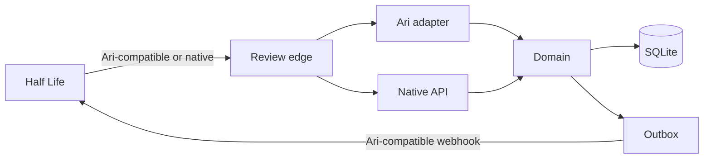

# 06 – Integration

This document is the contract between Review and Half Life. It is written to be implementable without reading the rest of the plan, and to be copied into `/docs` on the Review site.

## The boundary

Review owns:

- the review queue, claims and drafts;
- evidence snapshots for a submission version;
- automatic check results;
- stage transitions and hold reasons;
- decisions, notes, hours adjustments and the audit trail;
- outbound delivery to Half Life.

Half Life owns:

- participants, projects, phases and submissions;
- hours computation, tiers, grants, credit, the ledger and printer awards;
- maker notifications and the participant-facing status;
- identity verification and the fraud flag on the account.

Review never writes a ledger entry, a tier, a grant or a maker notification. It sends a decision and Half Life applies it through the existing `finalizeReview` path.

## Compatibility strategy

Review exposes two surfaces:

1. **Ari-compatible edge** – same endpoints, signatures, event names and core payload shapes as Ari. Half Life can switch by changing config, not code.
2. **Native v1 API** – richer state: stage, checks, fraud, timeline, list-based reconciliation.

The Ari edge is a translation layer. The internal model is native. Do not let Ari's vocabulary leak into the database.



## Half Life constraints that shape the wire

These are encoded in Half Life and must be visible in Review's UI and validation. They are not Review's rules to change.

- **Build before design.** A build ship can arrive before its design is approved. Review can queue and review it, but a build approval must wait for `design_status = approved`. Return the refusal as a field-level problem, not a generic 500.
- **Design is the funding decision.** A design approval carries the tier and grant. A build approval does not. If the reviewer changes the tier, the outbound decision includes `tier_override`; otherwise Half Life uses the maker's requested tier.
- **Tier floor.** A design approval below the tier's funded hours is refused by Half Life. Review's decision form should show the floor and the tier step-down before the reviewer submits.
- **Stale Hackatime.** Half Life refuses an approval on stale data unless the reviewer supplies an explicit hours value. Review shows the stale state and requires an override.
- **Resolved submissions are immutable.** A decision for an already-resolved ship is `409`; Review records the delivery as failed/ignored, not as a second credit.
- **One open ship per external id.** The `409 already_queued` id is part of the contract, not an error to hide.

If Half Life changes one of these, the compatibility adapter, the UI policy and the contract tests change together.

## Ari-compatible edge

### Endpoints

| Method | Path | Auth | Purpose |
| --- | --- | --- | --- |
| `POST` | `/api/ingest/{program}` | HMAC | Create a ship |
| `POST` | `/api/ingest/{program}/withdraw` | HMAC | Withdraw an open ship |
| `GET` | `/api/ingest/{program}/status` | Bearer | Look up a ship by `external_id` or `id` |
| `POST` | `/api/ingest/{program}/status` | HMAC | Some clients send status as a signed POST; accept it as an alias |

The program id is opaque. Half Life's current `ARI_PROGRAM_ID` can be reused as the Review programme id, or mapped in config. Prefer a new program id and a mapping, so a rollback is unambiguous.

### Inbound signature

New senders:

```text
X-Ari-Timestamp: 1762264800
X-Ari-Signature: hex(HMAC-SHA256(program_signing_secret, timestamp + "." + raw_body))
```

Rules:

- The timestamp is integer Unix seconds, within 300 seconds of now.
- Sign the raw bytes, not a re-serialised body.
- Hex is case-insensitive; surrounding whitespace is tolerated.
- A timestamped request must not verify with the legacy body-only scheme.
- Legacy body-only signatures (no timestamp) are accepted only if the programme enables `allow_legacy_signature`; Half Life's current SDK sends a timestamp.
- A bad signature is `401 {"error":"bad_signature"}`. Do not parse the body before verifying it.

The same scheme applies to `/withdraw`.

### Status auth

`GET /status` has no body to sign, so authenticate with the programme signing secret as a bearer:

```text
Authorization: Bearer <program_signing_secret>
```

Lookup:

- `?external_id=<external_id>` returns the latest version for that project/phase.
- `?id=<ship_id>` returns a specific version.
- `?version=<n>` with `external_id` returns a specific version.
- Unknown → `404`; missing/wrong token → `401`.

### Ingest body

Accept Ari's documented fields and map them to the internal snapshot. The fields Half Life sends today are the contract; extra fields are additive.

```json
{
  "external_id": "proj_abc:design",
  "ingest_version": 1,
  "title": "Line follower",
  "description": "A line-following robot with a custom board…",
  "repo_url": "https://github.com/maker/line-follower",
  "demo_url": null,
  "thumbnail_url": "https://…/cover.jpg",
  "track": "hardware",
  "evidence": ["commits", "devlog", "elapsed"],
  "hackatime_projects": ["line-follower"],
  "journals": [
    {
      "at": "2026-10-28T18:00:00.000Z",
      "minutes": 95,
      "text": "Routed the board…",
      "markdown": "Routed the board…\n\n"
    }
  ],
  "maker": {
    "email": "maker@example.com",
    "name": "Maker",
    "slack_id": "U…",
    "hackatime_id": "12345"
  },
  "meta": {
    "program": "half-life",
    "phase": "design",
    "theme": "pcb",
    "week": 1,
    "requested_tier": 2,
    "submission_notes": "First PCB",
    "bom": [
      { "name": "RP2040", "qty": 1, "unit_usd": 1.2, "vendor": "…", "link": "…" }
    ],
    "hours": {
      "claimed_seconds": 30600,
      "journal_seconds": 22320,
      "hackatime_seconds": 8280,
      "timelapse_seconds": 5400,
      "sources": [
        { "kind": "journal", "seconds": 22320 },
        { "kind": "hackatime", "seconds": 8280, "project": "line-follower" }
      ]
    },
    "prior_reviews": [
      {
        "result": "RETURNED",
        "feedback": "Add a BOM table…",
        "reviewer": "…",
        "at": "2026-10-20T…",
        "invalidated": false
      }
    ]
  }
}
```

Rules:

- `external_id` is stable across resubmissions. Half Life's `<themeProjectId>:design|build` is perfect.
- `ingest_version` (Ari's revision of the payload) is stored; a changed payload with the same `external_id` but no new ship is a conflict. A resubmission is a new ship version.
- If an open ship already exists for `external_id`, return `409 {"error":"already_queued","id":"<existing id>"}`. Half Life's existing 409 adoption path records the id instead of retrying forever.
- If the ship is a resubmission, the new version gets `version = previous + 1` and `previous_submission_id`.
- `meta.phase` is `design` or `build`; `meta.theme` is the theme slug; `meta.week` is the programme week.
- `meta.priority` (optional) sets the queue priority. The maker-facing priority form stays in Half Life; Review only consumes the flag.
- `meta.hours` is the exact breakdown Half Life computed. Review displays it; it does not independently decide the payout.
- `meta.prior_reviews` is optional context for the reviewer. It does not create review rows.
- `journals[].minutes` is accepted for Ari compatibility; convert to seconds at the boundary. New senders should send `seconds`.
- `hackatime_projects` is the list Ari counts. Review's live Hackatime check is advisory; the ingest number is the snapshot.
- `thumbnail_url` and cover URLs must be HTTPS.

### Ingest response

```json
{
  "id": "sub_01J…",
  "status": "accepted",
  "version": 1
}
```

`status` is `accepted` or `duplicate`. A duplicate is a successful idempotent replay. The SDK's create path expects `id` and `status`; keep them.

### Withdraw

```json
{ "external_id": "proj_abc:design" }
```

Response:

```json
{ "status": "withdrawn" }
```

`not_queued` is also a success when the ship was already decided or withdrawn. Only open ships can be withdrawn. A withdraw releases the claim and writes a timeline event; it does not send a review webhook (Half Life already knows it withdrew). If a receiver wants a `ship.withdrawn` event, it is additive and opt-in.

### Status response

Ari-compatible fields first, then the richer fields. Extra fields are safe for JSON clients.

```json
{
  "id": "sub_01J…",
  "external_id": "proj_abc:design",
  "version": 2,
  "phase": "reviewed",
  "decision": "approved",
  "review": {
    "approved_seconds": 30600,
    "approved_minutes": 510,
    "approved_hours": 8.5,
    "seconds_breakdown": {
      "hackatime": 8280,
      "journals": 22320,
      "lapse": 0,
      "program": 0
    },
    "note_to_maker": "Nice board. The BOM is clear and the firmware is tidy.",
    "audit_note": "Checked the board and the routed files.",
    "reviewer": { "email": "reviewer@example.com", "slack_id": "U…" },
    "justification": {
      "hackatime_projects": "line-follower 10/20/2026-10/28/2026",
      "technical_features": "Custom RP2040 board, line sensor array, motor driver",
      "deflation_reason": null
    }
  },
  "stage": 2,
  "stage_history": [
    { "stage": 1, "decision": "approved", "reviewer": "reviewer@example.com", "at": "…" },
    { "stage": 2, "decision": "approved", "reviewer": "organizer@example.com", "at": "…" }
  ],
  "checks": {
    "overall": "warn",
    "results": [
      {
        "key": "repo.readme.images",
        "status": "warn",
        "summary": "1 image (recommended 2)",
        "checked_at": "…"
      }
    ]
  },
  "fraud": {
    "status": "passed",
    "provider": "external",
    "score": 8,
    "summary": "Consistent identity and evidence."
  },
  "timeline": [
    { "kind": "ingested", "at": "…" },
    { "kind": "checks_ready", "at": "…" },
    { "kind": "claimed", "at": "…", "actor": "reviewer@example.com" },
    { "kind": "decided", "at": "…", "actor": "reviewer@example.com" }
  ],
  "updated_at": "…"
}
```

`phase` mapping:

| Internal | Ari `phase` |
| --- | --- |
| `checking` | `processing` |
| `needs_attention` | `processing` |
| `ready` / `claimed` / `in_review` | `review` or `under_review` |
| `stage2_hold` + fraud pending | `fraud_review` |
| `stage2_hold` | `second_pass` |
| `decided` | `reviewed` |
| `withdrawn` | `withdrawn` |
| `reverted` | `reverted` |

`decision` is `null` until final, then `approved`, `changes` or `rejected`.

`review` is present only when there is a final decision. A held stage 1 decision is visible in `stage_history` and in the native stage fields, but not as `review` (Ari's status does not expose a held decision as final). The native API exposes both.

### Withdraw/status response codes

| Code | Meaning |
| --- | --- |
| `200` | Accepted / found |
| `201` | Created |
| `400` | Invalid payload |
| `401` | Bad signature or bearer |
| `404` | Unknown ship |
| `409` | `already_queued` / `stale_version` / `not_open` |
| `422` | Validation error with `field` |
| `429` | Rate limited; `Retry-After` |
| `500` | Unexpected; retry |

## Native v1 API

All native endpoints are under `/api/v1`. Browser endpoints use the session cookie; machine endpoints use `Authorization: Bearer <integration key>` or the same HMAC as ingest.

### Machine

| Method | Path | Purpose |
| --- | --- | --- |
| `POST` | `/api/v1/ingest/{program}` | Create a ship (same body as the Ari edge, plus native fields) |
| `POST` | `/api/v1/withdraw/{program}` | Withdraw |
| `GET` | `/api/v1/status/{program}?external_id=…` | Full current state |
| `GET` | `/api/v1/status/{program}?id=…&version=…` | Specific version |
| `GET` | `/api/v1/reviews/{program}?since=…&cursor=…&limit=…` | Final decisions since a time |
| `GET` | `/api/v1/events/{program}?since=…&cursor=…&limit=…` | All transitions since a time |

`reviews?since` is the answer to "a delivery was lost". It returns the same review payload as the webhook, plus the submission and check summary. A receiver can page it and apply missing decisions idempotently.

`events?since` is the answer to "what happened to this queue?" It returns ingestion, checks ready, claims, holds, decisions, fraud, withdrawals and overrides. It is not a substitute for the audit log (no actor IP), but it is enough to reconcile.

### Browser

| Method | Path | Purpose |
| --- | --- | --- |
| `GET` | `/api/v1/me` | User, memberships, permissions |
| `GET` | `/api/v1/programs/{program}/queue?stage=1&…` | Queue page |
| `GET` | `/api/v1/programs/{program}/submissions/{id}` | Review bundle |
| `POST` | `/api/v1/programs/{program}/submissions/{id}/claim` | Claim |
| `POST` | `/api/v1/programs/{program}/submissions/{id}/heartbeat` | Extend claim |
| `DELETE` | `/api/v1/programs/{program}/submissions/{id}/claim` | Release |
| `PUT` | `/api/v1/programs/{program}/submissions/{id}/draft` | Save draft |
| `POST` | `/api/v1/programs/{program}/submissions/{id}/decision` | Stage 1 decision |
| `POST` | `/api/v1/programs/{program}/submissions/{id}/stage2/confirm` | Confirm |
| `POST` | `/api/v1/programs/{program}/submissions/{id}/stage2/override` | Override |
| `POST` | `/api/v1/programs/{program}/submissions/{id}/stage2/send-back` | Send back |
| `POST` | `/api/v1/programs/{program}/submissions/{id}/checks/{group}/rerun` | Re-run checks |
| `GET` | `/api/v1/programs/{program}/reviewed?…` | Decided list |
| `GET` | `/api/v1/programs/{program}/activity?…` | Activity |
| `GET` | `/api/v1/programs/{program}/stats` | Counts and metrics |
| `GET`/`PUT` | `/api/v1/programs/{program}/settings` | Policy (admin) |
| `GET`/`POST`/`DELETE` | `/api/v1/programs/{program}/members` | Roster (admin) |
| `GET`/`POST`/`DELETE` | `/api/v1/programs/{program}/forms` | Checklist/fields/snippets |
| `POST` | `/api/v1/programs/{program}/outbox/{id}/resend` | Manual resend (admin) |

### Decision body

```json
{
  "decision": "approved",
  "version": 2,
  "note_to_maker": "Nice board.",
  "internal_note": "Checked the routed files.",
  "hours_approved_seconds": 30600,
  "hours_adjustments": null,
  "tier_override": null,
  "grant_override_cents": null,
  "fields": {},
  "checklist": [],
  "acknowledgements": ["repo.readme.images"],
  "idempotency_key": "dec_01J…"
}
```

Rules:

- `version` must match the ship the reviewer saw. A mismatch is `409 stale_version`; reload.
- `hours_approved_seconds` is the number shown to the reviewer. If omitted, Half Life uses its own computed value; if present, it is an explicit override on Half Life's side.
- `note_to_maker` is required for `changes` and `rejected`; optional for `approved` unless policy says otherwise.
- `internal_note` is required for overrides/send-backs; optional at stage 1 by default.
- `acknowledgements` must match the latest warnings for this version; the server validates.
- `idempotency_key` is unique per submission. A retry returns the original review; it does not create a second.

### Stage 2 bodies

```json
{ "decision": "approved", "note_to_maker": "Confirmed.", "idempotency_key": "s2_…" }
```

```json
{ "decision": "changes", "note_to_maker": "…", "reason": "…", "idempotency_key": "s2_…" }
```

```json
{ "reason": "Needs a fresh first pass.", "idempotency_key": "s2_…" }
```

Confirmation cannot be the organiser's own stage 1 decision. Override requires `reason`. Send-back invalidates the held review and returns the ship to stage 1.

## Outbound webhooks

### Events

Keep Ari's event names so Half Life's handler works unchanged. Add fields, not new event names, where possible.

| Event | When | Required fields |
| --- | --- | --- |
| `review.approved` | Final approval | `id`, `external_id`, `decision`, `review`, `ship` |
| `review.changes` | Final request for changes | same |
| `review.rejected` | Final rejection | same |
| `review.fraud` | Fraud verdict at stage 2 | `id`, `external_id`, `fraud` |
| `review.reverted` | An admin reverted a decision | `id`, `external_id`, `reason` |
| `review.requeued` | An admin requeued a decided ship | `id`, `external_id`, `reason` |
| `ship.updated` | A reviewer corrected metadata (if enabled) | `id`, `external_id`, `changes` |

A held stage 1 decision does **not** emit a review event. It is not final. The stage 2 decision emits the final event, with `stage: 2` and a `stage_history` array. This is the fix for "the programme sees a decision before the second pass".

### Payload

```json
{
  "event": "review.approved",
  "id": "sub_01J…",
  "external_id": "proj_abc:design",
  "decision": "approved",
  "stage": 2,
  "stage_history": [
    { "stage": 1, "decision": "approved", "reviewer": "reviewer@example.com", "at": "…" },
    { "stage": 2, "decision": "approved", "reviewer": "organizer@example.com", "at": "…" }
  ],
  "maker": { "email": "…", "name": "…", "slack_id": "…" },
  "ship": {
    "title": "Line follower",
    "description": "…",
    "track": "hardware",
    "repo_url": "…",
    "demo_url": null,
    "thumbnail_url": "…",
    "hackatime_projects": ["line-follower"]
  },
  "review": {
    "approved_seconds": 30600,
    "approved_minutes": 510,
    "approved_hours": 8.5,
    "seconds_breakdown": { "hackatime": 8280, "journals": 22320, "lapse": 0, "program": 0 },
    "note_to_maker": "…",
    "audit_note": "…",
    "reviewer": { "email": "…", "slack_id": "…" },
    "justification": {
      "hackatime_projects": "line-follower 10/20/2026-10/28/2026",
      "technical_features": "…",
      "deflation_reason": null
    }
  },
  "checks": {
    "overall": "warn",
    "results": [ { "key": "repo.readme.images", "status": "warn", "summary": "1 image" } ]
  },
  "fraud": { "status": "passed", "score": 8, "summary": "…" }
}
```

The `review` object matches Ari's fields Half Life reads, including `approved_seconds`, `approved_minutes`, `approved_hours`, `seconds_breakdown`, `note_to_maker`, `audit_note`, `reviewer` and `justification`. Extra fields are additive.

`review.fraud` keeps Ari's shape for the handler Half Life already has:

```json
{
  "event": "review.fraud",
  "id": "sub_…",
  "external_id": "proj_abc:design",
  "fraud": {
    "verdict": "failed",
    "checks": [
      {
        "email": "maker@example.com",
        "slack_id": "U…",
        "trust_score": 2,
        "justification": "The evidence and identity do not line up."
      }
    ]
  }
}
```

Half Life only reads `fraud.verdict` and the length of `fraud.checks`; the per-maker detail is for a human. `review.reverted` and `review.requeued` keep `id`, `external_id` and a `reason`; Half Life's reset path reads the first two and ignores the reason.

### Signature

```text
X-Ari-Timestamp: 1762264800
X-Ari-Delivery-Id: 01J…
X-Ari-Signature: hex(HMAC-SHA256(outbound_secret, timestamp + "." + delivery_id + "." + raw_body))
```

Rules:

- `outbound_secret` is separate from the ingest signing secret. Half Life's `ARI_WEBHOOK_SECRET` is the outbound secret.
- Timestamp is Unix seconds. A receiver should reject outside 300 seconds; Half Life's SDK does.
- Sign the exact bytes sent.
- `X-Ari-Delivery-Id` is unique per delivery. A manual resend gets a new id; the original id is kept in the audit.

### Retries

- `2xx` → delivered. Any body is fine.
- `4xx` except `408`, `425`, `429` → failed permanently (the receiver says the payload is wrong). Record the body for an operator.
- `5xx`, timeout, connection error, `429` → retry.
- Backoff: 30s, 2m, 10m, 30m, 2h, 6h, 12h, 24h. Maximum 8 attempts over ~48 hours, configurable.
- Respect `Retry-After` on 429.
- A job retry is at-least-once; the receiver dedupes by delivery id.
- An outbox row is `failed` after the last attempt; it stays visible in admin with the last error and payload. A manual resend creates a new delivery id.

### What the receiver can always do instead

If the outbound path is down, Half Life can:

- `GET /api/v1/reviews/{program}?since=<last seen>` and apply decisions idempotently.
- `GET /api/v1/status/{program}?external_id=…` for one ship.
- `GET /api/v1/events/{program}?since=…` for a full replay.

This is the design goal: no admin-panel archaeology, no resend scripts as the primary recovery path.

## Half Life changes

### Minimal cutover (no Half Life code)

1. Create the programme in Review; set the signing and outbound secrets.
2. Register Review's outbound URL and secret in Half Life's Ari endpoint config (the same `ARI_WEBHOOK_SECRET` the handler verifies).
3. Set Half Life's environment:
   - `ARI_BASE_URL=https://<review-host>`
   - `ARI_PROGRAM_ID=<review program id>`
   - `ARI_SIGNING_SECRET=<review signing secret>`
   - `ARI_WEBHOOK_SECRET=<review outbound secret>`
4. Run `ari-retry` (or wait for it) to replay unsent hand-ins.
5. Verify a synthetic ship end-to-end before switching real traffic.

Half Life's `lib/ari.ts` keeps working because the edge speaks Ari. Its `sendSubmissionToAri`, `withdrawSubmissionFromAri`, `reconcileAriDecisions` and webhook handler are unchanged. The `ari-review-counts` script's status reads work; `review` is now populated with notes and hours, so its repair path has less to do.

### Native migration (later)

Half Life's `lib/ari.ts` is 1,300 lines of compatibility workarounds. The native API lets it shrink:

- `lib/review.ts` with `ingest`, `withdraw`, `status`, `reviewsSince`, `eventsSince`.
- Use `reviewsSince` in a reconciliation job instead of per-ship `status` reads.
- Delete `ari-resend-all`, `repair-ari-decisions`, `adoptStatusPlaceholder` and the phase polling once the native API is the source.
- Read `checks` in Half Life's `/review` console if it remains; or link to Review and retire the console.

Do this after the compatibility cutover is stable. Do not combine the cutover with a Half Life refactor.

### What not to change in Half Life

- `finalizeReview` remains the only writer of credit.
- `ariExternalId` remains `<themeProjectId>:design|build`.
- Half Life's `PhaseSubmission` remains its own hand-in record. Review's `submission_id` is a separate id; the mapping is `external_id` + version.
- Half Life's maker notifications remain in its decision path.

## Shadow, pilot, cutover, rollback

### Shadow

- Half Life sends the same ship to Ari and Review (a temporary dual-send in the `after` hook, or a replay job).
- Review runs checks and shows a read-only queue; reviewers stay in Ari.
- Compare check results, queue counts, and decisions.
- Exit criteria: check parity is understood; no crashes; outbound signatures verified; queue load is acceptable.

### Pilot

- Choose one theme/week or one reviewer group.
- For those ships, send only to Review; keep Ari for the rest.
- Review makes final decisions; Half Life applies them through the same webhook.
- Exit criteria: a week of real decisions, no split-brain, no missed deliveries, reviewer feedback positive.

### Cutover

- Flip the environment for all ships.
- Keep Ari's programme open read-only for history.
- Run the reconciliation job from Review's `reviews?since` (or Half Life's existing `ari-retry`) for a week.
- Monitor queue age, delivery failures, check errors, reversals.

### Rollback

- Flip Half Life's env back to Ari.
- Replay open ships to Ari (Half Life's `ari-retry` will send them because their `ariSubmissionId` is null or belongs to the old programme; a small migration may be needed to clear the Review ids).
- Decisions already made in Review remain in Half Life. Do not re-apply them to Ari; Ari only needs the open queue.
- If Review made a decision that Half Life has not applied, deliver it before switching, or reconcile it via `reviews?since`.
- Document the exact commands in the runbook. A rollback that requires a database edit is not a rollback.

### Historical data

- Start with the open queue. Closed submissions do not need to be migrated to Review to launch.
- Ingest can carry `meta.prior_reviews`, so a reviewer sees the project's history without a backfill.
- Optional: a one-off importer from Half Life's `SubmissionReview`/`PhaseSubmission` for `reviewed` reporting. Mark imported rows `historical=1`; do not run checks; do not emit webhooks.
- Do not import Ari's internal review rows; Half Life's own review rows are the record of what the maker was told.

## Documentation

The `/docs` page on Review is part of the product, not an afterthought. It must include:

- the ingest body with a field table and a cURL example;
- the signature scheme with a working example;
- the status response and phase mapping;
- the outbound events and signature;
- retry semantics and idempotency;
- the reconciliation endpoints;
- a troubleshooting section: bad signature, 409 already_queued, 422 field, delivery failed, fraud pending.

Every wire change updates `/docs` and the contract in the same pull request. A contract change without the doc is incomplete.

## Example: signed ingest

```sh
BODY='{"external_id":"proj_abc:design", ...}'
TS=$(date +%s)
SIG=$(printf '%s.%s' "$TS" "$BODY" | openssl dgst -sha256 -hmac "$PROGRAM_SIGNING_SECRET" -hex | cut -d' ' -f2)

curl -X POST "https://review.example.com/api/ingest/half-life" \
  -H "content-type: application/json" \
  -H "X-Ari-Timestamp: $TS" \
  -H "X-Ari-Signature: $SIG" \
  --data-binary "$BODY"
```

## Example: status

```sh
curl "https://review.example.com/api/ingest/half-life/status?external_id=proj_abc%3Adesign" \
  -H "Authorization: Bearer $PROGRAM_SIGNING_SECRET"
```

## Example: reconcile

```sh
curl "https://review.example.com/api/v1/reviews/half-life?since=2026-11-01T00:00:00.000Z&limit=100" \
  -H "Authorization: Bearer $INTEGRATION_KEY"
```

The response includes a `next_cursor`; page until it is null, apply each decision idempotently, and store the last `decided_at` as the next `since`.

## Failure handling

| Failure | Sender sees | Receiver should |
| --- | --- | --- |
| Bad signature | `401 bad_signature` | Fix the secret; do not retry blindly |
| Stale timestamp | `401 bad_signature` | Fix clock skew; retry with a fresh timestamp |
| Duplicate delivery | `200` duplicate | Treat as success |
| Open ship conflict | `409 already_queued` with `id` | Record the id; do not retry forever |
| Version conflict | `409 stale_version` | Refetch status; reapply against the current version |
| Validation | `422` with `field` | Fix the payload; do not retry unchanged |
| Rate limit | `429` with `Retry-After` | Back off |
| Server error | `500` | Retry with backoff |
| Webhook delivery failed | Outbox `failed` | Reconcile via `reviews?since`; or resend from admin |
| Fraud pending | Status `stage2_hold` / `fraud_review` | Wait; do not treat as decided |
| Held decision | Status `second_pass` | Wait; no review event yet |

## Versioning

- The ingest body accepts additive fields. A new required field is a new API version, not a silent change.
- Outbound payloads add fields; they do not remove or repurpose existing ones.
- `ingest_version` is the sender's revision. `version` is the ship number. Do not confuse them.
- The native API is `/api/v1`; a breaking change is `/api/v2`.
- The Ari-compatible edge follows Ari's documented contract; if Ari changes, the adapter changes, not the domain.
