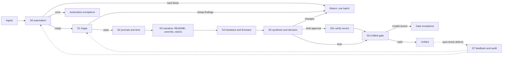

# 09 – Review pipeline

- **Status:** proposal for discussion
- **Date:** 2026-11-09
- **Scope:** the path from ingest to Unified, and how review work is divided between automation, AI and people
- **Related:** [01-product.md](./01-product.md) (stages), [04-checks.md](./04-checks.md) (check catalogue), [05-ui.md](./05-ui.md) (queue and review screen), [decisions.md](./decisions.md) (ADR-004)

## The short version

The current two-pass model asks every reviewer to hold the whole project in their head, and asks the second pass to read it all again. That is why reviews feel heavy and why the second pass duplicates the first. It is also why returns are serial: the reviewer stops at the first problem, the maker fixes one thing, and the project comes back to find the next problem.

This document proposes replacing the two passes with **a pipeline of small stations**, each asking one question with the evidence needed to answer it, plus a **findings ledger** that survives resubmissions and a **return gate** that returns everything at once. Automation runs first, AI pre-answers what it is reliable at, and humans do the smallest judgement they can. The output of the pipeline is not a verdict; it is a **Unified-ready record** with its evidence attached.

The recommendation is to adopt the goals, not the literal board. Build the findings ledger, the return gate, per-entry time and three human stations first. Split stations further only where the data shows a bottleneck or an error. The full kanban is an organiser view, not a reviewer workspace.

## 1. What is actually wrong

### 1.1 Two full passes over the same project

The second pass is a duplicate by construction. It re-opens the same repository, the same README, the same journals and the same checks, and makes the same judgements a second time. It adds one pair of eyes but no new information. The organiser still has to verify the fields after Airtable, so the second pass is not even the last look.

The duplication is expensive and it teaches reviewers that the first pass does not have to be complete. If someone else will read it again, why be certain?

### 1.2 Returns are serial

The most-returned project in production has been returned 12 times. That is not a maker problem alone. Each return is a full cycle: new version, new checks, new claim, new review. A reviewer who finds one problem and returns immediately forces the maker through one cycle per problem, and forces the next reviewer to rediscover the rest.

A return should be a **complete list of everything the maker must change**, not the first thing that was noticed.

### 1.3 The reviewer is the state store

The review screen has tabs for artifacts, but the review is a sequence of questions. Nothing on the page records "I checked the repo, it is real", "the PCB matches the BOM", "this hour was a tutorial build". Those conclusions exist only in the reviewer's head, so every tab switch evicts one. Re-opening evidence is not a search problem; it is a memory problem.

This is also why the missing technical-features and deflation fields hurt more than their size suggests. They are not just compliance fields. They are the places where conclusions are supposed to live.

### 1.4 The definition of done is after Airtable

The pipeline currently ends when the decision reaches the platform, the platform writes Airtable, and Airtable submits to Unified. Then a human checks screenshots, justifications and repo links again. That means the review tool's "done" is not the programme's "done". Every field that still needs a manual check after Airtable is a station that exists in the wrong place.

### 1.5 Effort is uniform, risk is not

Every project gets roughly the same review, whether it is a 1-hour warm-up or a 30-hour build. The fine model is not uniform: a bad 30-hour project can cost hundreds. Human minutes should be spent in proportion to exposure, not in equal slices.

### 1.6 The output is a verdict, not a record

The current output is a decision, hours and notes. The reasoning, the evidence and the per-question answers are scattered across a bundle that only exists in the review app. The platform gets a result, not a case file. The programme and Unified cannot see why the result is trustworthy.

## 2. What the proposal gets right

- **The unit of work is a question, not a project.** That is the correct atom. It is what makes specialisation, automation and measurement possible.
- **Column orientation exposes the work.** A station queue is a better home for a reviewer than a mixed list of projects with ten columns of data.
- **Automation first.** Anything deterministic should run before a human spends a second on it.
- **Per-journal deflation.** Cutting at the entry and generating the justification from those cuts is much better than typing one number and one paragraph at the end. It also matches what deflation is for: a lower bound on productive struggle.
- **Sync-commit filtering.** The platform's automatic commits are noise. Excluding them from authorship and work-history signals is correct and should be a first-class rule, not a reviewer's memory.
- **The factory metaphor.** It is right, but not because factories are assembly lines. It is right because factories have standard work, quality at the source, visual management, and a feedback loop from defects. A line without those is just more process.
- **No manual checks after Airtable.** That is the right target, and it is achievable if the gate validates a record instead of a feeling.

## 3. First principles

1. **One question, one reading, one answer.** A station is the smallest unit that can be answered without holding another station's conclusion in your head. If it needs three artifacts, it is two stations. If the answer is obvious after a 30-second read, it is one station.
2. **No answer twice.** If an artifact has not changed, its answer carries forward. If a question was answered at one station, another station reads the answer, not the artifact.
3. **Collect before returning.** A return is a batch. The reviewer may not return with an incomplete list of findings for the envelope they are working in.
4. **Automate the deterministic, pre-answer the probabilistic, reserve people for judgement.** AI should reduce reading and pre-fill answers, not make money or return decisions.
5. **The tool holds the state.** Every conclusion, with the evidence that produced it, must be persisted the moment it is made.
6. **The output is a record.** The decision is one field in it. The record is what the programme, Unified and the auditor receive.
7. **Human minutes follow risk.** Hours, grant size, theme, history and flags decide how many stations run and how much is audited.
8. **Quality is escaped defects, not throughput.** The number that matters is how many bad projects reach Unified, and what they cost. Items per hour is a trap.
9. **Shift left.** The cheapest defect is the one the maker fixes before submitting. The submit gate in Half Life is the first review station.
10. **A station is only worth having if it catches something the previous station and the synthesis cannot.** Otherwise it is a tax on the maker's cycle time.

## 4. The models

These are the models worth arguing about. They are not mutually exclusive; the recommendation is a hybrid.

### Model 0 – Current two-pass

One reviewer does everything at stage 1. Policy holds some approvals for stage 2, where an organiser reads everything again (and fraud runs). Changes and rejections are final and skip stage 2.

**Strengths:** one person holds the whole project, no handoffs, familiar, already built.

**Costs:** duplicate second pass, serial returns, high recall load, no structured findings, uniform effort, no record.

**Verdict:** the baseline to beat, not a model to keep.

### Model 1 – The worksheet (single reviewer, externalised state)

One reviewer still does the whole review, but the screen becomes a worksheet of required questions beside the evidence. Each question has a verdict, an evidence link and a justification; the page shows progress; the decision is generated from the answers. The reviewer never has to remember what they concluded, but they still own the whole case.

**Strengths:** fixes recall, missing fields and note generation; no handoffs and no cycle-time penalty; small change to the current app; good for small programmes and for training; works as the fallback for the station model.

**Costs:** one person still does everything; does not remove duplicate second-pass work; does not by itself fix early returns; scales by hiring, not by process.

**Verdict:** the right first step for the review page, and the right "cell mode" for the pipeline. Not sufficient on its own.

### Model 2 – The question pipeline (the proposal)

Work is split into stations, each with its own queue. A project moves through the stations; each station asks one question and produces one answer. Automation and AI run before the human stations. The queue page becomes a board of stations.

**Strengths:** specialisation, minimal mental effort per station, automation and AI insertion points, parallelism, per-station metrics, consistency from standard work, easy to route by theme and skill.

**Costs:** every handoff loses context; more queues mean more WIP and potentially longer cycle time; granularity has a reading cost; a literal board is not a work surface; specialisation can create blind spots; the model is only as good as its station definitions.

**Verdict:** directionally right, but "more passes" is not automatically faster. It needs batching, routing, carry-forward and a return gate to beat the current model.

### Model 3 – Batched triage + deep review

Three human stations: **triage** (collect all cheap issues in one pass), **deep review** (artifacts and judgement, split only if needed), and **synthesis** (compose the return or the approval). Automation runs before triage. The deep station can itself be several sub-queues, but the project does not leave the phase until its findings are collected.

**Strengths:** solves the serial-return problem with two envelopes instead of twelve cycles; only two handoffs; keeps the deep reviewer's context; much cheaper to build than a full board; measurable.

**Costs:** less parallel than a full pipeline; the deep station is still heavy; needs a findings ledger and a return gate to work.

**Verdict:** the best first target. It captures most of the benefit at a fraction of the process cost.

### Model 4 – Risk-tiered pipeline

Routing is based on exposure: hours, grant, theme, flags, maker history, reviewer history. Low-risk projects get automation plus one human confirmation and sampling. High-risk projects get the full station graph and 100% audit. The middle gets a light path.

**Strengths:** spends human minutes where the fines are; makes the economics explicit; scales to 1000+ without reviewing everything equally.

**Costs:** requires a calibrated risk model; a misroute can let a bad project through; needs governance and a sampling policy so the low-risk path is not a blind spot.

**Verdict:** necessary at scale, but only after the pipeline produces the data to calibrate it. Start with a simple hours-and-flags rule, not a score.

### Model 5 – Verification-only second pass

Stage 2 stops being a second review. It verifies the record: are the station answers present, is the evidence attached, is the time ledger consistent, is the note complete, are there open findings, is the risk acceptable? High-risk cases get a full re-read; low-risk cases get sampling. Changes and rejections are still final and still skip it.

**Strengths:** removes the duplicate work; turns the second pass into quality control; cheap; preserves accountability.

**Costs:** a sample can miss; verification is only as good as the station records; needs a real audit policy.

**Verdict:** adopt it regardless of the other models. The second pass should never redo the first.

### Model 6 – The hybrid (recommended)

Automation (S0) feeds a batched triage (S1), then a set of deep stations by artifact (S2 journals and time, S3 narrative, S4 hardware and firmware), then synthesis and decision (S5), then an automated Unified gate (S6), with a sampled audit (S7) fed by post-Unified outcomes. Stations are derived from policy per theme. Findings are batched by envelope. Resubmissions carry answers forward and verify fixes only.

Reviewers work a **station queue**, not a board. Organisers work the board. A "cell mode" lets one reviewer run all stations for a project when the queue is small or the case is complex.

**Verdict:** the destination. Build it in the order in section 7, not all at once.

### Model 7 – Shift-left maker preflight (complementary)

The same checks and cheap questions run at submit time in Half Life, before a project enters the review queue. The maker sees "your repo link does not resolve", "your cover image is missing", "your README has no build steps", "this is 95% the starter project", and fixes it at zero review cost. The review pipeline only handles what a human must see.

**Strengths:** prevents work instead of speeding it up; improves the maker's experience; reduces triage and returns; the highest leverage in the whole system.

**Costs:** requires platform work outside Ire; risks a stricter submit gate that blocks beginners; the same policy fixture must be shared with the submit gate to avoid drift.

**Verdict:** do it in parallel with the pipeline. It is not a substitute for review, but it is the cheapest defect removal available.

### Comparison

| Model | Handoffs | Duplicate work | Return quality | Cycle time | Build cost | Scales to 1000+ | Risk control |
| --- | --- | --- | --- | --- | --- | --- | --- |
| 0 Two-pass | 0-1 | High (2nd pass) | Poor (serial) | Medium | Done | By hiring | Uniform |
| 1 Worksheet | 0 | High (2nd pass) | Medium (if ledger) | Good | Low | By hiring | Uniform |
| 2 Full pipeline | Many | Low | Good (if batched) | Variable, often worse | High | Good if parallel | By station |
| 3 Batched triage | 2 | Low | Good | Good | Medium | Medium | By phase |
| 4 Risk-tiered | 2-6 | Low | Good | Best | Medium-high | Best | Explicit |
| 5 Verification pass | 1 | None | N/A | Good | Low | Good | Sampling |
| 6 Hybrid | 2-6 | Low | Good | Good | Medium | Good | Explicit |
| 7 Shift-left | 0 | Prevents work | N/A | Best | Platform work | Best | Prevention |

## 5. A critical read of the station plan

### 5.1 More passes do not automatically mean faster

Every station boundary is a handoff. The project waits in a queue, someone loads context, reads the prior answers, makes one decision and puts it down. If the station is not small enough to be answered from one artifact, the context load is large; if it is too small, the load recurs at the next station. The gain comes from **specialisation and no duplicate reading**, not from the number of passes.

Little's law is blunt: throughput is work in progress divided by cycle time. More queues with more cards in flight can make the board look busy while every project takes longer. WIP limits, auto-advance and a "cell mode" are not optional extras; they are what keeps the line from turning into a queue of queues.

### 5.2 Granularity is set by reading cost, not by the check list

"As granular as possible" is the wrong rule. The right rule is: **one reading, one question, one answer**. If two questions need the same README, ask them at the same station. If a question needs the README and the hardware files, it is probably two questions. Splitting by check is not the same as splitting by question; a dozen checks can produce three questions.

### 5.3 Automatic stages are not human queues

Projects waiting on checks do not belong in a reviewer's queue. They belong in a status and, if checks error, in an **automation exception** queue. Putting them on the board as a column adds WIP that nobody can work. The board can show a "waiting on automation" swimlane for organisers; reviewers should not see it as work.

### 5.4 Kanban drag is not the right reviewer interaction

Dragging a card is slower than the card moving itself. In the normal path, answering the last required question should advance the card automatically. Dragging is for **rerouting and escalation**, with a reason. A board with eight columns and 1000 cards is another overview; the station queue is the work surface. Reviewers should see **their station**, not the whole board.

### 5.5 Per-station independence conflicts with batched returns

If each station can return the project the moment it finds something, the 12-return problem gets worse, not better. Independence is useful for **collecting** findings and bad for **acting** on them. The pipeline needs an explicit return gate and an envelope: the set of stations that must finish before a return can be issued. The station model and the batch model are compatible only if the gate exists.

### 5.6 Specialisation creates blind spots

A person who only looks at journals stops noticing that the README contradicts the BOM. A person who only looks at hardware stops noticing that the hours are implausible. The synthesis station and cross-station flags are the countermeasures. Rotate stations occasionally; keep the project header and prior answers visible everywhere; make "I noticed something for another station" a first-class action.

### 5.7 AI is a pre-answer, not a judge

AI is good at extracting, summarising, comparing and flagging. It is bad at being accountable. A false rejection or a plagiarism accusation costs trust and can cost the maker the project; a fine costs money but a false accusation costs the programme's legitimacy. Use AI to reduce reading and to pre-fill the human's answer, require evidence, and audit a sample. Do not let it decide hours, returns or fraud.

There is also automation bias: a reviewer who sees "AI: pass" 50 times will stop looking. The countermeasures are evidence-first presentation, hiding the AI answer until the human answers on high-risk cases, and measuring agreement per station.

### 5.8 Uniform stations recreate uniform effort

If every project visits every station, the 1-hour warm-up costs the same as the 30-hour build. That is the current problem with a different shape. Route by theme (a CAD project has no firmware station), by phase, and by exposure (hours, grant, flags). The station graph is policy, not a fixed assembly line.

### 5.9 The 12-return case is a process defect

A project returned 12 times means the return process failed 12 times, not just the maker. Each return should have carried every known finding; the next version should have verified the fixes and only asked for what remained. The tooling should detect "no changes since the last version" and refuse to burn a reviewer on it. It should escalate a case after three returns, not let it loop. Treat the Starbie case (Vihaan Negi, 14 versions, approved at 14) as the first case study: list every return reason, find which station should have caught it, and fix that station or the return gate. [10-implementation.md](./10-implementation.md) has the version-by-version table.

### 5.10 Station definitions are the product now

Once the pipeline exists, the station questions, examples, evidence rules and severity policy are what determine quality. They must be versioned, owned by a named person, reviewed against spot-check data, and editable without a deploy. If they are hard-coded in components, the pipeline will calcify in a month.

### 5.11 The Unified boundary is still manual

A beautiful pipeline that ends at Airtable and a human checklist has not solved the goal. The gate must validate the **Unified-ready record** and send it, or the last station is still a person with a spreadsheet. That requires knowing the Unified schema and deciding whether Ire writes it directly or through the platform.

## 6. The recommended model

### 6.1 Shape



The external stage model stays: S0 is stage 0, S1-S5 happen inside stage 1, S5v is the stage 2 verification of a held decision, and S7 is the post-Unified audit and feedback loop. Only approvals can be held; changes and rejections stay final and skip S5v. The platform keeps seeing stage 1 and stage 2; the stations are an internal dimension. The Ari-compatible edge and the outbound event shapes do not change.

A project's current station is **derived** from the answers and open findings, not stored as a single mutable field. That keeps the board and the queues consistent and makes "move the card" a reroute action rather than the normal path.

### 6.2 Stations

| Station | Human? | Reads | Asks | Produces | Target |
| --- | --- | --- | --- | --- | --- |
| S0 Automation | No | Repo, payload, Hackatime, clips, demo, duplicates | Is it there, public, readable, complete, plausible? | Check results, auto-findings, pre-answers | Seconds |
| S1 Triage | Yes, cheap | Cover, description, repo link, check summary, images | Is this a real project with a real description and a real screenshot? | Triage findings, hard-block decision | 30-60s |
| S2 Journals and time | Yes, heavy | Journals, clips, Hackatime, commits | Is each entry descriptive, and how much of it is productive time? | Time ledger, deflation reasons, journal findings | 3-8 min |
| S3 Narrative | Yes, medium | README, description, commits, files | Does the repo tell a coherent, authored story that matches the claims? | Feature justification, README/commit findings | 2-5 min |
| S4 Hardware and firmware | Yes, hardware confidence | Design files, BOM, firmware, README claims | Is the design plausible, and does the firmware match the claim? | Note-only findings, feature evidence | 2-6 min |
| S5 Synthesis | Yes, decision | All answers and findings | What is the outcome, the hours and the note? | Decision, maker note, internal note, record | 1-3 min |
| S5v Verification (stage 2) | Yes, organiser | The record, station answers, a sample of evidence | Is the record complete and are the answers right? | Confirm, override or send back; audit verdict | 2-4 min |
| S6 Unified gate | No | The record and the schema | Is every required field present and valid? | Sent record or field-level exceptions | Seconds |
| S7 Audit and feedback | Yes, sampled | A sample of answers and evidence | Was the station right? | Audit verdicts, station error rates | 1-2 min per sample |

S1 is deliberately separate from S3: the cheap check gates the expensive reading. S2 and S4 can run in parallel when staffing allows because they read disjoint artifacts; S3 and S2 share the repository but not the same questions. Start linear; add parallelism when wait time dominates.

S0 does not decide whether the project is good. It decides whether the project is reviewable and what evidence exists. A hard block follows policy: it can return to the maker with the automated findings, or go to the automation exception queue when the check could be wrong. An ambiguous, timed-out or errored check goes to the exception queue with a retry. A warning continues to S1 and is visible there. Automation is bounded by what it was written to look for, so it is never the end of the list.

**S1 details.** Triage answers only questions that do not need deep reading: is the cover a screenshot of this project, does the description describe it, does the repo link lead to the right project, are the required images present, is the maker's profile usable (a real display name, not a placeholder), is there anything in the check summary that makes the project un-reviewable. It also confirms or rejects the AI's pre-answers. Hard blocks (private repo, no journal, wrong project) return immediately with everything known. Everything else is batched into the cheap envelope and returned once.

**S2 details.** The time station is the money station. Each entry is read once, answered for quality and cut once. Auto-suggestions propose cuts from clip coverage, entry duration, Hackatime overlap, idle gaps and starter-project diffs; the reviewer confirms or edits. The output is a time ledger, not a number.

**S3 details.** The narrative station reads the README, the description and the commits as one story: what did the maker build, did they explain the problems they hit, do the commits show their work, do the claims match the files, and is the README plausibly AI-generated? AI-likeness is a flag for a human, never a rejection. This station also produces the technical-features justification as structured rows plus a summary, because it is the station that reads the claims. It is required for approval under the current policy, and it is a policy flag rather than a universal law: the programmes that do not need it can turn it off.

**S4 details.** Hardware review is note-only by default: a non-working board is expected for a beginner and is not a rejection reason, but it must appear in the note to the maker. Route it to a reviewer with hardware confidence where possible; a generalist can take it with the handbook, and cell mode lets one reviewer do it in context. Do not make hardware confidence a hiring requirement for the whole team. Firmware starter detection is mostly automated (tree and file hashes against the starter), with a human look only when the diff is substantial but suspicious.

**S5 details.** Synthesis is the only station that decides. It reads the answers, resolves conflicts, ensures every open returnable finding is either fixed or included in the return, sets the hours from the ledger, generates the maker note from the findings, writes the internal note, and selects the outcome. It is short because the reading is already done.

**S5v details.** A held decision goes to verification, not to a second review. The organiser checks that the record is complete, that every required station has an answer with evidence, that the time ledger balances, that there are no open returnable findings and that the note is actionable. They open a sample of the evidence, weighted by risk. They confirm, override with a reason, or send back to a named station. Fraud runs here and only here. The question is "should this record stand?", not "what do I think of this project?".

**S6 details.** The gate validates the record against the Unified schema: required fields, working URLs, present screenshots, hours and ledger consistency, justification, no open returnable findings, no unverified fixes, identity, policy. It sends or raises field-level exceptions. No routine human check.

**S7 details.** Audit samples station answers, not projects. For high-risk projects, 100% of S2/S4 answers; for low-risk, a small sample. Disagreements become station error rates, calibration examples and definition changes. This is the quality loop, not a second review.

### 6.3 The findings ledger

A finding is a problem or a note that outlives a station, a decision and a resubmission.

```text
finding
  id
  submission_id
  version_opened
  station_key
  question_key
  severity        block | fixable | note | hold
  status          open | fixed | accepted | disputed | withdrawn
  summary         one line the maker can act on
  detail          internal explanation
  maker_action    what the maker must do, or empty for note-only
  evidence        JSON: file, line, URL, journal entry, check key, image region
  opened_by
  resolved_by
  resolved_version
  resolution      why it is fixed, accepted or disputed
```

**Severities.**

- **block** – review cannot proceed, and the project is not reviewable in this version: private repo, missing journal, wrong project. Return now.
- **fixable** – the project can be reviewed but cannot reach Unified: missing screenshot, placeholder description, README that does not explain the build, missing required file. Collect and return in a batch.
- **note** – useful to the maker but not a reason to return: a hardware bug, a weak commit message, a design concern. Include it in the note; keep going.
- **hold** – a policy hold: fraud, plagiarism suspicion, identity mismatch. Escalate; do not return from the station.

**Lifecycle.** A finding is opened by the station that can prove it, with evidence. It stays open across versions until the owning station verifies the fix. On a resubmission, the fix-verification station checks each open finding against the new artifact, marks it fixed or still open, and records how. Findings do not silently disappear because the file changed; changing a file is not fixing the problem.

**The return gate.** A return is a composed document, not a station action:

1. The gate lists every open finding in the current envelope, grouped by severity and maker action.
2. The reviewer can remove a finding only with a reason; the removal is audited.
3. If a required station in the envelope has not run, the gate warns with the number of unrun stations and requires a reason to return anyway.
4. Hard blocks bypass the envelope and return immediately with what is known.
5. The generated maker note is editable; it opens with the actionable list, not with prose.
6. The next version shows "3 of 5 findings fixed" and routes only what remains.

This is the direct answer to the 12-return problem. The cheap envelope (S1) is one return at most. The deep envelope (S2-S4) is one return at most. Within a version family, two returns is the normal ceiling; more means the maker did not fix, the fix was not verified, or the station was wrong. All three are visible.

Automation will only flag what it was written to find. That is not a weakness of the gate; it is why the envelope includes the human stations before a return and why every station can add a finding for another station. The gate does not pretend the list is complete because a script ran; it makes the human list complete before it leaves.

**Worked example: the 12-return case.** Say the first version had a placeholder description, no screenshots, a missing BOM table, a thin journal and a starter firmware. Under the proposal, S0 and S1 collect the description, screenshots and BOM and return once; the maker fixes all four. On v2, fix verification closes the triage findings, S2 finds the thin journal and cuts 1.2h, and S3 finds the starter firmware; those are batched and the project returns once with two findings. On v3, fix verification closes them and S5 approves. Two returns, not twelve, and each note was the complete list. If a station misses the starter firmware, the audit or the next version catches it, not the maker's seventh attempt.

### 6.4 Time and deflation

The time ledger is the source of the approved number, not a text field.

```text
captured = journal entries + Hackatime + programme additions, with overlaps removed
approved = sum of per-entry approved seconds + per-source adjustments
deflated = captured - approved
```

Each cut has a reason from a small taxonomy: tutorial consumption without application, starter build with no original work, idle gap, duplicate with Hackatime, non-project work, unverifiable, unreasonably long, other. The reason is required for any cut; "other" requires a sentence. The project-level justification is **generated** from the cuts and must answer why the number is reasonable for this maker's skill level, not only what was built. A feature list is not a justification: "an intermediate maker would take about 4h for this articulation, so 4.5h is reasonable" is. The time station asks for that benchmark explicitly and the generated sentence includes it.

> Approved 5.5h of 6.4h. Cut 0.5h of tutorial build (entry 3) and 0.4h of idle time (entry 4). No Hackatime overlap. The remaining 5.5h is productive board bring-up, firmware and enclosure work; an intermediate maker would take about 6h for this board and firmware, so 5.5h is reasonable.

The reviewer edits the sentence, not the arithmetic. The ledger travels with the record, so the programme and Unified can see how the number was reached.

**Invariants.** Approved never exceeds captured. Approval below a policy floor (for example, 50% of captured) requires a second look or a hold. A claim above the tier cap is an automatic finding. A project above the hours threshold is routed to a senior time reviewer and audited in full.

### 6.5 Resubmission and fix verification

Every artifact gets a stable hash: README blob, cover image, each journal entry, the commit range, the design files. On a new version:

- S0 re-runs the checks that can change.
- The fix-verification queue item checks each open finding against the new version and its diff; fixed findings close, the rest stay open.
- S2-S4 are **not re-run for unchanged artifacts**. Their answers carry forward with the hash.
- Changed artifacts re-open only the questions that read them.
- A version with no changes since the last one is auto-returned with "no changes detected" and the open findings; it does not consume a review.
- After three returns, the case moves to a **stuck** queue for an organiser. After five, policy decides: a call with the maker, a rejection, or an extension. The loop is not allowed to run forever.

This is where most of the speed comes from. Resubmissions are a large share of queue volume; not re-reading unchanged work is cheaper than any station design.

### 6.6 AI policy

Use AI for:

- extracting the sentences and images that answer a question;
- comparing a project to the starter template and to other submissions;
- summarising long journals and commit ranges;
- pre-answering low-risk questions (cover is a screenshot, description is project-specific, README is plausibly AI-generated);
- flagging likely duplicate or copied text.

Do not use AI for:

- the final decision, the approved hours, a return or a rejection;
- a plagiarism or fraud accusation without a human confirming the evidence;
- silently skipping a station.

Guardrails: every AI answer stores the model, version, prompt version and the evidence it used; the human confirms before it counts; high-risk cases hide the AI answer until the human answers, to avoid anchoring; a sample is audited; agreement, precision and recall are measured per station; the provider is not sent secrets, PII or private identity data.

### 6.7 The Unified gate

Define the Unified-ready record explicitly, then validate it in S6:

- submission and version identifiers;
- title, maker display name, theme, track, phase, week, tier;
- approved seconds and the time ledger;
- technical-features justification and the feature rows;
- description, README link, repo link, demo link, cover image and screenshots;
- BOM total and lines;
- station answers summary and findings resolution;
- decision, maker note, internal note, reviewer identity;
- policy version, station versions, timestamps.

Validation is mechanical: required fields present, URLs resolve, images exist and are not placeholders, hours match the ledger, no open returnable findings, no unverified fixes, no unresolved warnings, identity verified, grant within cap. If it passes, the gate sends. If it fails, the exception names the field and the station that owns it.

The record has two faces. The programme-facing section carries everything the Airtable view and the programme need, including the technical-features justification and the time ledger. The Unified-facing section carries what Unified actually stores and validates. Do not force every programme field into Unified; do force every Unified field to be present and valid before the record leaves. That distinction is the difference between "we checked the fields" and "the record is correct".

The decision is that Ire does not write Unified directly. Unified holds PII for tens of thousands of people, so even a well-scoped API key is more risk than the problem is worth. The record goes to the platform, which writes the Half Life Airtable; the final submission to Unified stays a deliberate manual step for now. The gate validates the Airtable-facing record so that the manual step is a send, not a re-check. The pipeline should not care, but the record must carry the reasoning; a decision plus a note is not enough. Extend the outbound payload or expose a record URL that the platform can fetch. Otherwise all the new structure is lost at the boundary.

### 6.8 Reviewer experience

The reviewer's home is a station queue, not a board:

```text
S2 · Journals and time                          today: 12 items
[ 14.1h ] Displays · Weather clock · 6 entries · v2   [ open ]
[  8.5h ] PCB · Line follower · 4 entries · v1       [ open ]
[  3.2h ] CAD · Desk lamp · 3 entries · v1           [ open ]
```

Opening an item shows the project header (title, theme, hours, risk, prior answers) and the station's artifact and question. The answer controls are three buttons and a keyboard shortcut; a finding opens a small evidence form; the card advances automatically when the answer is complete. Undo is available for a few seconds.

The board is an organiser view: columns per station, WIP counts, age in station, assigned reviewer, risk flags, stalled badges. Drag is for reassigning or escalating, with a reason. Clicking a card opens the station view for that item.

**Cell mode.** A reviewer can take a whole project and run S1-S5 in sequence with the same components and a progress strip. No handoffs, no station queues, the worksheet guides the order. This is the default for a generalist programme like Half Life, and the right mode for small queues, complex cases, training, and a reviewer who wants to finish what they started. Station queues are a way to batch similar work when the volume justifies it, not a requirement. It is also the bridge from the current app: the worksheet is cell mode.

**Handbook.** Each station shows a one-page definition: the question, what counts as evidence, three pass examples, three finding examples, what to escalate, and the policy version. This is the standard work that makes specialisation consistent.

**Cross-station flags.** Any station can add a finding for another station without leaving the current item. The finding appears in the other queue with the evidence attached. This is how a journal reviewer flags a hardware concern without pretending to be a hardware reviewer.

### 6.9 Organiser experience

The organiser's board shows WIP, wait time and stalls by station; the stuck queue; audit samples; the Unified exceptions; and the weekly defect review. The organiser can reassign, raise WIP limits, change the station policy, and open a case history. They do not re-review every project; they verify the record and sample the answers.

### 6.10 Metrics and the feedback loop

| Metric | What it tells you | Target direction |
| --- | --- | --- |
| Escaped defects per 100 approved | Quality of the whole pipeline | Down |
| Fine cost per 100 projects | The business outcome | Down |
| First-pass yield | Share approved without any return | Up |
| Returns per project, p50/p90/max | Return quality and stuck cases | Down, and fewer >3 |
| Findings per return | Whether returns are complete | Up |
| Cycle time ingest to Unified, p50/p90 | Flow, not just touch time | Down |
| Station wait and touch time | Bottleneck and definition cost | Balanced |
| Fix rate on the next version | Whether the maker could act on the note | Up |
| Audit disagreement rate | Station reliability | Down |
| AI agreement and error rate | Whether the pre-answer is safe | Calibrated |
| Reversal and override rate | Decision quality | Down |

Guardrails: do not rank individual reviewers by items per hour. Publish station error rates and calibration examples, not names. Count a false return (a finding the maker disputes and wins, or a station answer the audit overturns) as a defect. Review the metrics weekly, change one station definition at a time, and keep the change in the policy version.

### 6.11 Data model sketch

Reuse the existing `submission`, `submission_version`, `claim`, `review`, `check_result`, `outbox` and `audit_log`. Add:

| Table | Purpose | Key fields |
| --- | --- | --- |
| `station_definition` | Versioned station policy | `program_id`, `key`, `version`, `label`, `question`, `themes`, `order`, `active` |
| `station_question` | One answerable question | `station_key`, `key`, `prompt`, `evidence_kind`, `required` |
| `station_answer` | The reviewer's answer | `submission_id`, `version`, `station_key`, `question_key`, `answer`, `evidence`, `artifact_hash`, `reviewer_id` |
| `finding` | The cross-version ledger | see 6.3 |
| `artifact_ref` | Carry-forward hashes | `submission_id`, `kind`, `key`, `hash`, `url` |
| `time_ledger_entry` | Per-entry cut and reason | `submission_id`, `version`, `entry_id`, `captured_seconds`, `approved_seconds`, `reason`, `note`, `reviewer_id` |
| `audit_sample` | Station quality control | `submission_id`, `station_key`, `reviewer_id`, `verdict`, `notes` |
| `unified_record` | The gate's payload and result | `submission_id`, `version`, `payload`, `validated_at`, `sent_at`, `errors` |

The station of a project is derived: the earliest required station in the theme's graph with an unanswered required question or an open returnable finding. When a theme allows independent stations, the project can appear in more than one queue; item-level claims keep two reviewers off the same question. Claims become item-level (`submission_id` + `station_key`), with a project-level lock only for synthesis. The existing claim TTL and heartbeat carry over.

## 7. Rollout

The order matters more than the destination.

### Phase 0 – Measure, ledger, return gate (1-2 weeks)

- Instrument the current review: time per tab, time to decision, evidence re-opens, returns per project, findings per return.
- Classify 50 recent returns and spot-check defects into a draft finding taxonomy.
- Add the findings ledger, the return gate and the generated maker note. No new stations.
- Add per-entry approved time and reason to the existing journal review, and generate the deflation justification.
- Add fix verification and no-change detection to resubmissions.
- Keep the two required fields; capture them in the decision payload and the outbound record.

**Acceptance:** returns per project down, findings per return up, no increase in median cycle time, zero no-change reviews, every return has a complete finding list for its envelope.

### Phase 1 – Three stations (2-3 weeks)

- Split the queue into S1 triage, S2-S4 as one evidence station with sub-questions, and S5 synthesis (the current review page).
- Auto-advance between stations; item-level claims; the board as an organiser view.
- Add the station handbook and the cross-flag action.

**Acceptance:** station wait and touch time measured; less than 5% of items re-enter a completed station; triage under 60 seconds; synthesis under 3 minutes on clean cases.

### Phase 2 – Split, pre-answer, route (3-4 weeks)

- Split evidence into S2 journals and time, S3 narrative, S4 hardware and firmware.
- Add AI pre-answers for cover, description, starter-project diff, README extraction and duplicate text, with the guardrails in 6.6.
- Add simple risk routing: theme prerequisites, hours thresholds, flags.
- Add the fix-verification queue and the stuck queue.

**Acceptance:** AI agreement measured on a sample; station error rates measured; high-risk projects get 100% audit; low-risk sampling defined; escaped defects down against the phase 0 baseline.

### Phase 3 – Gate and feedback (2-3 weeks)

- Validate the Unified-ready record in S6; remove the routine post-Airtable checks.
- Add the post-Unified defect loop and the weekly kaizen review.
- Extend the outbound contract or expose the record URL to the platform.

**Acceptance:** zero routine manual checks after Airtable; every Unified record validates; spot-check defects are classified and routed to a station.

### Phase 4 – Full graph and board (only if the data says so)

- Parallel stations with item-level claims, WIP limits, the full board, calibration and audit tooling.
- Consider automating clean low-risk approvals with sampling, if policy allows.

**Acceptance:** cycle time improves without a rise in escaped defects; no station exists that cannot name the defect it prevents.

## 8. Risks and open questions

**Risks.**

- **Handoff latency.** More stations can increase cycle time and WIP. Mitigate with auto-advance, WIP limits, cell mode and a "next item" pull.
- **Checklist theatre.** Reviewers pass items without looking. Mitigate with evidence requirements, audits, calibration and AI disagreement tracking.
- **Blind spots.** Specialisation hides cross-artifact contradictions. Mitigate with synthesis, cross-flags and rotation.
- **AI overreach.** False accusations and automation bias. Mitigate with human confirmation, evidence display and sampling.
- **Process rot.** Station definitions go stale. Mitigate with versioning, ownership and a weekly defect review.
- **Queue starvation.** Low-volume stations may wait days for one item. Mitigate with cell mode and cross-training.
- **Maker harm.** A stricter gate at submit or a faster return can frustrate beginners. Mitigate with clear, actionable notes and a "fix everything" checklist.
- **Boundary loss.** If the platform only accepts a decision and a note, the record is lost. Fix the contract before building the pipeline.

**Open questions.**

1. What exactly does the Half Life Airtable record require, field by field? Direct Unified writes are ruled out on PII grounds; the Airtable schema is now the contract that matters.
2. What do the spot-checkers actually check, and what are the current fine and change rates by reason? Build the control catalogue from the data, not from memory.
3. What is the volume and hours distribution by theme and track? Risk routing depends on it.
4. The reviewers are mainly generalists, so the default path is cell mode and all stations are open to every reviewer; specialisation is a routing tool, not a requirement. Is that still true during peak season, or will some stations get dedicated staff?
5. May AI see maker code, READMEs and images? Which provider, what retention, what consent?
6. Does policy require a human for every approval? If not, what sampling makes an automated clean approval acceptable?
7. What is the acceptable cycle time per station and end to end?
8. What does the maker see at submit time, and can the same checks run there?
9. Who owns each station definition, and how often is it reviewed against defects?
10. What happened in the 12-return case, return by return? The answer should be the first case study.

## Appendix A – Current checks to stations

| Current check or signal | Station | Human? | Notes |
| --- | --- | --- | --- |
| `repo.accessible`, `repo.tree`, `repo.readme`, `repo.readme.images`, `repo.readme.bom_table`, `repo.files.required`, `repo.design_files`, `repo.bom` | S0 | No | Hard blocks and warnings; pre-answers for S1/S3. |
| `repo.description` heuristic | S0 then S1 | Confirm | A short description is a flag, not a verdict. |
| Cover image URL and content type | S0 then S1 | Confirm | "Is this a screenshot of this project?" is a human/AI confirm. |
| `repo.commits`, authorship, spread, after-submit, sync commits | S0 then S3 | Glance | Filter sync commits before authorship. |
| `evidence.journals`, `journal.present`, `journal.wordless`, `journal.hours` | S0 then S2 | Yes | The time station reads every entry once. |
| Hackatime linked, time, stale, overlap | S0 then S2 | Confirm | Feeds the time ledger and suggestions. |
| Lapse clips and coverage | S0 then S2 | Confirm | Coverage is evidence, not a cut by itself. |
| `demo.reachable` | S0 | No | Bot walls and timeouts are errors, not fails. |
| Identity verified | S0 | No | Warning; payout gate stays in Half Life. |
| Duplicate repo, evidence, text | S0 then S3 | Confirm | Flags for the authenticity question. |
| Fraud provider | S5v hold | No | Stage 2 boundary; never stage 1. |
| Starter-project diff | S0 then S1/S4 | Confirm | Hash/diff is better than AI here. |
| AI-likeness of README and journals | S0 then S3/S2 | Confirm | Flag only; never auto-reject. |

## Appendix B – Spot-check reasons to controls

| Spot-check reason | Where it should be caught | Control |
| --- | --- | --- |
| Plausible but overinflated hours | S2 | Per-entry ledger, Hackatime overlap, clip coverage, hours-threshold routing, senior review. |
| Mild overuse of AI | S3 | README/claims station, AI-likeness flag, commit and journal consistency; note or changes, not an auto-reject. |
| Missing screenshots | S0/S1, and the maker submit gate | Image checks, screenshot confirmation, preflight at submit. |
| Bad repo link | S0/S1 | Link resolution, wrong-project check, preflight at submit. |
| Plagiarised project | S0/S3/S5v | Duplicate repo/text/evidence, authorship, authenticity escalation, human confirmation. |
| Entirely fraudulent hours | S2/S5/S5v | Time ledger, fraud provider, audit sampling, hold. |
| One-shot AI-generated project | S0/S3/S5v | Starter diff, commit spread, journal/code consistency, authenticity station. |
| Non-working project | S4 | Note to the maker; not a rejection by itself. |

## Appendix C – Glossary

- **Station:** one question, the artifact needed to answer it, and the answer record. A queue of those items.
- **Envelope:** the set of stations that must finish before a return may be issued. The cheap envelope is S1; the deep envelope is S2-S4.
- **Finding:** a problem or note with severity, evidence and a lifecycle across versions.
- **Return gate:** the composed return that lists every open finding in the envelope and requires a reason to omit one.
- **Record:** the Unified-ready payload: decision, hours, time ledger, justification, notes, evidence and station answers.
- **Cell mode:** one reviewer runs all stations for a project in sequence, with no handoffs.
- **Escaped defect:** a project that reached Unified and was later changed or removed by a spot-checker.
